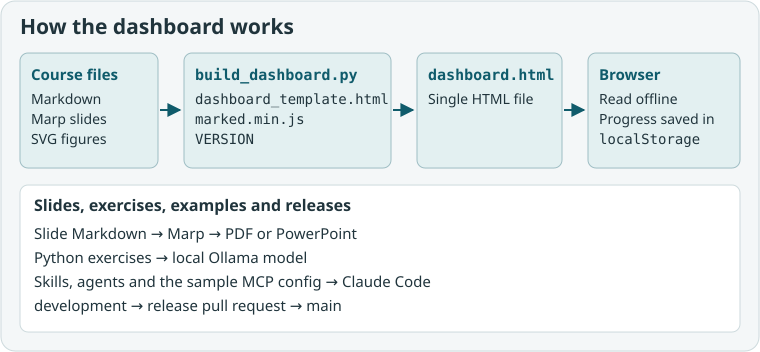

# Contributing

How changes to Decoding AI are made, committed and released.

## Branches

| Branch | Purpose |
|---|---|
| `main` | Released course only. Participants clone this. Never commit here directly. |
| `development` | All day-to-day work. Merged into `main` at release time. |

For a large or experimental change (a new module, a dashboard rewrite) you
can branch off `development`, for example `feature/module-07`, and merge it
back when it works. Small changes go straight onto `development`.

## Commit messages

We use [Conventional Commits](https://www.conventionalcommits.org):

```
<type>(<scope>): <summary in the imperative, max 72 characters>

<body: why the change was made and what it affects, wrapped at ~72
characters. The diff already shows what changed.>

<footer: issue references, BREAKING CHANGE: ..., Co-Authored-By: ...>
```

| Type | Use for | Example |
|---|---|---|
| `feat` | new content or functionality | `feat(module_04): add MCP database exercise` |
| `fix` | corrections | `fix(module_02): correct prompt example output` |
| `docs` | README, guides, reference text | `docs: update clone instructions` |
| `style` | layout or formatting only | `style(figures): align module colours` |
| `refactor` | restructuring with the same result | `refactor(course): split build script` |
| `chore` | housekeeping, version bumps | `chore(release): v1.1.0` |

The scope is optional: use a module (`module_03`), `course`, `dashboard`,
`figures` or `background`.

- Keep one logical change per commit, and leave the course working after
  each one.
- Before pushing, you may squash messy local work-in-progress commits into
  clean ones. Don't rewrite commits that are already pushed.

## Versions

Versions follow `MAJOR.MINOR.PATCH`:

- **MAJOR** (`2.0.0`): course restructure, such as modules added, removed
  or reordered.
- **MINOR** (`1.1.0`): new chapter, exercise or dashboard feature.
- **PATCH** (`1.0.1`): typos, broken links, small fixes.

The `VERSION` file in the repository root is the single source. The build
puts it in the dashboard title, menu, footer and every export.

## Under the hood



Run `python course/build_dashboard.py` from the repository root when you
change content that goes into the dashboard. The build packs the Markdown,
slides and SVG figures into `course/dashboard.html` with the template,
bundled Markdown renderer and version number. Open the file locally to
check the result. The browser stores progress in localStorage.

Run `python course/build_dashboard.py --check` before committing. It compares
the expected UTF-8/LF bundle with the checked-in file and exits nonzero
if the dashboard is missing or stale. It leaves the file untouched.

The dashboard menu shows a short build fingerprint. Hover over it or
export a problem report for the full SHA-256. It covers the builder,
template, bundled renderer, and the effective course payload, including
the version and embedded figures. Identical inputs produce identical
bytes across dates. The fingerprint identifies the bundle even when
built from local edits, while Git identifies the checkout.

For a published bundle, first commit the source changes and their rebuilt
dashboard. Then run `python course/build_dashboard.py --pin-source`.
It verifies that the committed dashboard at `HEAD` matches the current
fingerprint, records the source commit in `course/dashboard_source.json`
and rebuilds the HTML with commit-specific hosted source links. Commit
those two generated files together and run the check again. If the
effective inputs change, a normal rebuild drops the old pin.

The [reproducibility guide](docs/reproducibility.md) records the tested
runtime, slide export and local-model setup.

Dashboard progress storage lives in `course/dashboard_progress.js` and is
inlined by the builder. After changing the progress contract, open
[the browser checks](course/tests/progress.html) locally. Then rebuild
the dashboard and exercise Preferences → Load progress from the HTML.
Open the [download checks](course/tests/downloads.html) after changing
the download adapter, or run `python -m unittest discover -s course/tests` for Markdown section and
checklist ID tests.

The Dictionary view lives in `course/dashboard_dictionary.js`. The template
supplies course links, figure rendering, and preference storage. Open the
[Dictionary checks](course/tests/dictionary.html) locally after changing
that interface.

The Wrap-up view lives in `course/dashboard_wrapup.js`. Its callers supply
checklist and note operations. Open the [Wrap-up checks](course/tests/wrapup.html)
locally after editing the view.

The chapter view lives in `course/dashboard_chapter.js`. The dashboard
supplies Markdown rendering, read-aloud, and saved-note and navigation
operations. Open the [chapter checks](course/tests/chapter.html) locally
after changing that interface.

The [step contract](course/dashboard_step_kinds.json) defines lesson kinds,
the renderer each kind uses, and its payload fields. To add a kind with
an existing renderer, add its mapping there and use it in the module
configuration. A genuinely new renderer also needs an implementation in
the dashboard. The build rejects invalid steps before writing the HTML.

Course Markdown logic lives in `course/dashboard_markdown.js`. The
dashboard supplies route lookup, checklist persistence, and clipboard
actions. Open the [Markdown browser checks](course/tests/markdown.html)
after changing the parser, link rewriting, checklist behavior, or formatting.

## Releasing

1. On `development`, set the new number in `VERSION` and in the title line
   of `README.md`.
2. In `CHANGELOG.md`, rename `[Unreleased]` to `[X.Y.Z] - YYYY-MM-DD` and
   start a new empty `[Unreleased]` section above it.
3. Rebuild the dashboard with `python course/build_dashboard.py` and commit
   the release inputs as `chore(release): vX.Y.Z`.
4. Pin the source as described above, commit the generated files, and push
   `development`.
5. Open a pull request from `development` to `main` and merge it with a
   **merge commit**, not a squash. Squashing would break the shared history
   between the two branches and cause conflicts at the next release.
6. Tag the merge on `main` and push the tag:

   ```bash
   git switch main && git pull
   git tag -a vX.Y.Z -m "vX.Y.Z"
   git push origin vX.Y.Z
   git switch development
   ```

7. Optionally, create a GitHub Release from the tag, using the changelog
   section as release notes.

To see only the releases on `main`, use `git log --first-parent main`.
