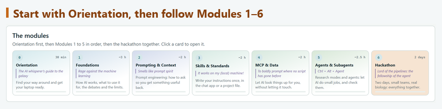
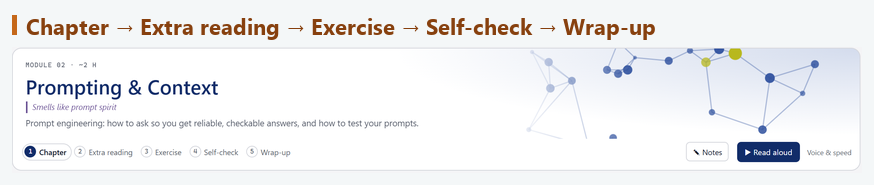
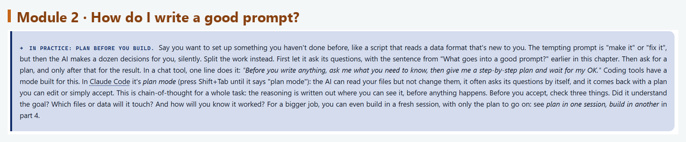
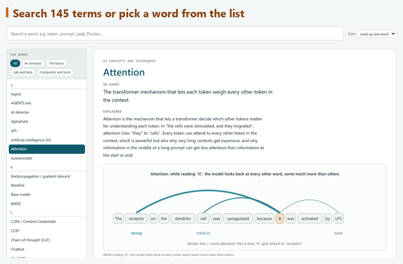
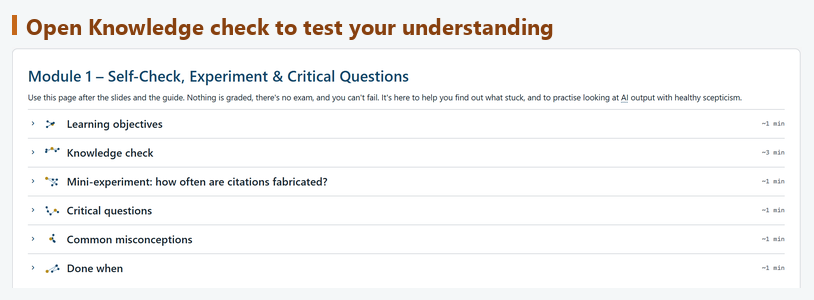

# Decoding AI · v1.0.0

Decoding AI is a hands-on course for colleagues in a lipidomics and
immunology lab. It covers where AI can help in daily research, how to ask
for useful answers, and how to check the results before relying on them.
The exercises include no-code routes.

> **Privacy first.** Treat pre-publication omics data, patient-derived
> material and unpublished manuscripts as confidential. Read Part 3 of
> [Module 1](module_01_foundations_and_privacy/README.md) before using cloud
> models with lab data, and Part 3 of
> [Module 5](module_05_agents_and_subagents/README.md) before deploying
> autonomous agents.

*AI assisted in writing this course, drawing on online sources and practical
experience. The material was reviewed and may still contain errors. Please
flag anything that looks wrong.*

## Open the dashboard



Download and extract the ZIP from GitHub under **Code**, or clone the
repository. Open the local copy of [course/dashboard.html](course/dashboard.html)
in your browser. The dashboard works offline and keeps your progress in
that browser.

Start with **Orientation**. Work through **Foundations**, **Prompting &
Context**, **Skills & Standards**, **MCP & Data**, and **Agents & Subagents**
in order. Finish with the **Team Hackathon** in Module 6.

<br clear="all">

## Work through a module



Open the **Chapter** and select a section title to expand it. The tabs
take you to the exercise, the self-check and the wrap-up. Some modules
also have **Extra reading** or slides you can come back to at any time.

Look for **In practice** boxes as you read. In Module 2, expand
**How do I write a good prompt?** to find **Plan before you build**.
It shows how to get the AI to ask questions and propose a plan before
it writes anything.





Open **Dictionary** from the sidebar when a term is unfamiliar. You
can search all 145 terms or select a word from the list. The entry
for **Attention** shows how a diagram can help explain a concept.

<br clear="all">

## Check your understanding



Use **Self-check** to test what you remember and try the mini-experiments.
Start with **Knowledge check** in Module 1, then try the citation exercise
to see how easily a plausible-looking reference can turn out to be wrong.

<br clear="all">

## Optional setup

The dashboard and no-code routes are enough to start. For the local
model exercises, install [Ollama](https://ollama.com) and Python, then
follow the [Module 1 exercise](module_01_foundations_and_privacy/README.md#exercise-run-a-model-locally).
For Claude Code examples or slide exports, follow the instructions in
the [course guide](course/README.md) and the relevant module.

To verify a local Ollama installation, run these commands from the
repository root after starting Ollama.

```bash
python -m pip install requests
ollama pull llama3.1:8b
python module_01_foundations_and_privacy/exercises/test_ollama_local.py
```

## Help improve the course

If you find a broken example or something that needs explaining, include
the module, section and what you saw when you report it. Use synthetic
data in examples you share. See the [contributing guide](CONTRIBUTING.md)
for how to propose and check changes.
