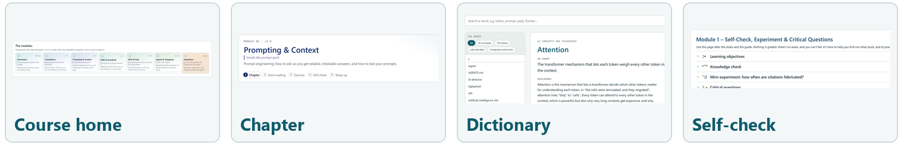

# Decoding AI · v1.0.0

  

  
  

  Practise using AI in a lipidomics and immunology lab. 
  Try it on everyday research tasks, compare results, and bring what works to a team hackathon.

  

## What you'll do

- **Learn the basics.** See where AI can help in research and where it tends to get things wrong.
- **Give it a better brief.** Add context, ask for clarifying questions, and try planning before building.
- **Check the answers.** Use the self-checks and mini-experiments to spot problems like invented citations.
- **Build with your team.** Try skills, data tools and agents, then put them to work in the hackathon.

## Start the course

1. Choose **Code → Download ZIP** on GitHub and extract the archive, or clone the repository.
2. Double-click `course/dashboard.html` to open it in your browser.
3. Choose **Begin with the orientation**, then work through Modules 1–5. Module 6 is the team hackathon.

The dashboard works offline and saves progress in your browser. Each exercise has a no-code route. The [Setup guide](https://github.com/HoltropAF/Decoding_AI_course/wiki/Setup-guide) covers Ollama, Claude Code and Marp if you want to try them.

> **Privacy first.** Treat pre-publication omics data, patient-derived material and unpublished manuscripts as confidential. Read Part 3 of [Module 1](module_01_foundations_and_privacy/README.md) before using cloud models with lab data and Part 3 of [Module 5](module_05_agents_and_subagents/README.md) before deploying autonomous agents.

## Learn more

The [wiki](https://github.com/HoltropAF/Decoding_AI_course/wiki) has a [dashboard walkthrough and troubleshooting](https://github.com/HoltropAF/Decoding_AI_course/wiki/Using-the-course), an [optional setup guide](https://github.com/HoltropAF/Decoding_AI_course/wiki/Setup-guide), and a [developer guide](https://github.com/HoltropAF/Decoding_AI_course/wiki/Developer-guide) for rebuilding the dashboard. Running a group? Start with the [facilitator guide](course/facilitator_guide.md).

Found a mistake or a broken example? [Open an issue](https://github.com/HoltropAF/Decoding_AI_course/issues) with the module, section and what you saw. Use synthetic data in anything you share.

*AI assisted in writing the course, drawing on online sources and practical experience. The material was reviewed and may still contain errors.*
