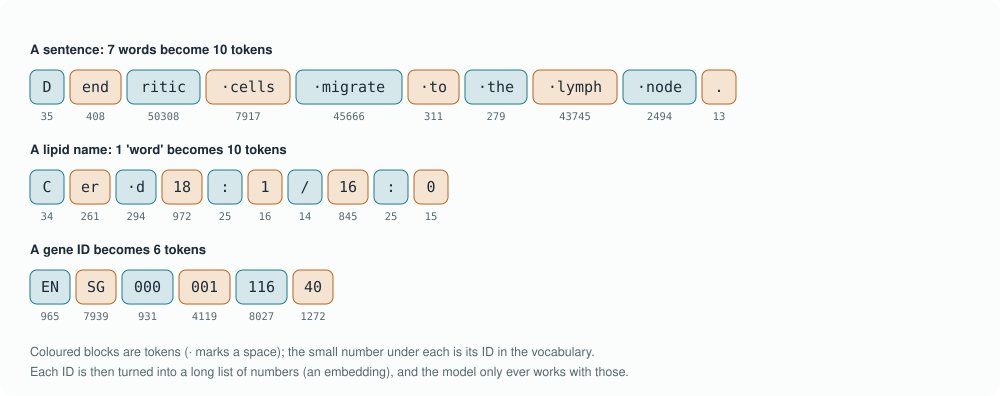
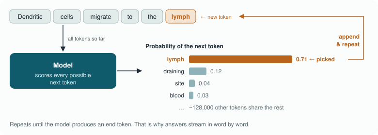
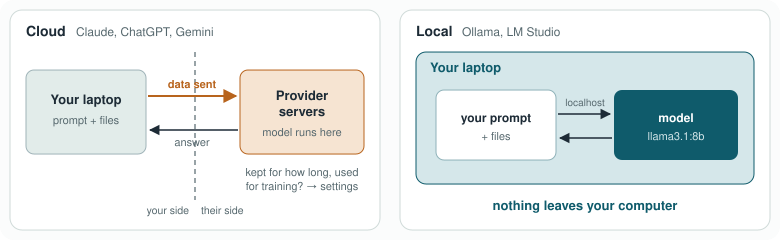
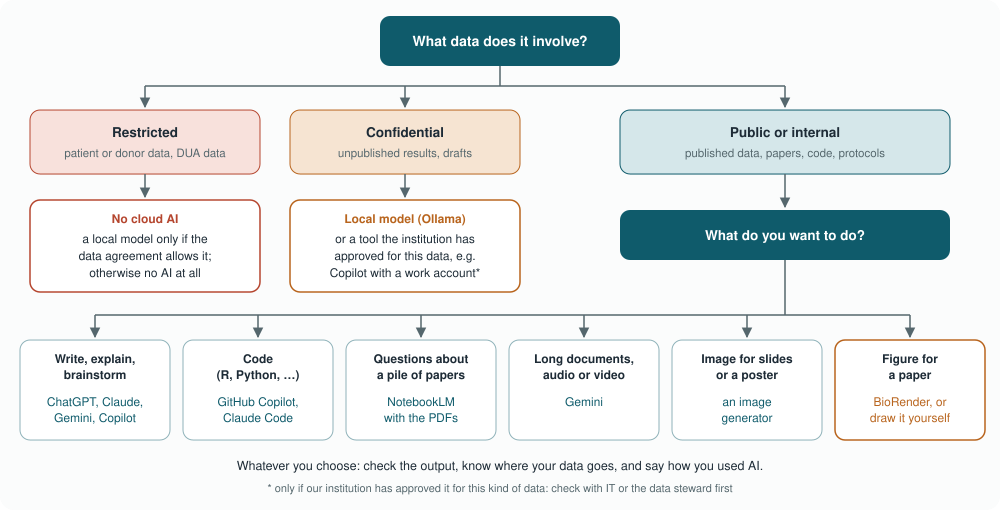

# Module 1 · Foundations

This chapter is about one thing: understanding AI well enough to use it
with confidence. Not to build it, and not to become an expert, but to know
what is actually happening when you type a question into ChatGPT or Claude.
That is what lets you judge when to trust an answer and when to check it,
and what you may and may not paste into a chat window.

Why does that matter? Listen in at any lunch table in the institute and
you'll hear three kinds of stories. One colleague asked ChatGPT to
summarise a paper, and it did a brilliant job. Another asked it for
references on a lipid transporter and got three that don't exist. A third
pasted a table of unpublished results into a chat window last week, and has
been quietly wondering since whether that was okay. All three come down to
the same two questions: *what is this thing actually doing?* and *where does
my data go?* By the end of this chapter you can answer both, and you'll see
that the brilliant summary and the invented references come from exactly
the same mechanism.

We get there in four steps. First, **what AI is**: a whole family of
techniques, of which the chatbots are just one member. Then **how it
works**: how a language model writes, how it learned, and why that makes it
make things up. Then **how to use it safely**: where your data goes, which
data may go where, which tool to pick, and how to use it day to day. And
finally **the bigger picture**: whether anyone can tell what AI made, and
the debates around it. None of this needs a computer science background; if
you have ever explained a western blot to your family, you can handle it.
By the end of the exercise you'll even have a model running on your own
laptop, which is a surprisingly satisfying moment.

It's a long chapter, so grab a coffee and feel free to read it in two
sittings: parts 1 and 2 one day, parts 3 and 4 the next. Part 2 is the heart
of the course; its subsection *What's inside?* goes a level deeper and is
optional. If you hit an unfamiliar term, hover over any word with a dotted
underline for a quick definition, or open the **Dictionary** in the
sidebar.

> **In this chapter**
> - **What is AI?** Why AI is hard to define, the AI family from rules to LLMs, and the difference between predicting and creating
> - **How does it work?** Tokens, how a model writes and learns, why it makes things up, and what it's good and bad at
> - **How do I use it safely?** Where your data goes, which data may go where, which tool to choose, and everyday use
> - **The bigger picture:** watermarks and AI detectors, and the big debates around AI
> - **Time:** about 95 minutes of reading, plus about 75 minutes for the exercise and self-check
> - **You need:** Ollama and `llama3.1:8b` for the exercise (download before the session). Only if you want to have some hands-on work though!

A few tips before you start. Install Ollama and download the model *before*
the session, because it's about 5 GB and conference Wi-Fi will not love
you. If your laptop has less than 16 GB of memory, use a smaller model
(`llama3.2:3b`); it's less clever, but fine for the exercise. And bring one
example from your own work where you used, or wanted to use, ChatGPT or
Claude: we'll use those in the discussion.

---

## 1. What is AI?

### What do we mean by "AI"?

Let's start with the word itself, because it is harder to pin down than
you'd think. "AI" gets used for almost anything these days, from a spam
filter to a chatbot that drafts your methods section, and there is no
single definition that everyone agrees on, not even among AI researchers.
Part of the problem is the second word. We don't have a precise definition
of *intelligence* in people either, so it's no surprise that "artificial
intelligence" is fuzzy too.

The term itself dates from 1955, when the computer scientist John McCarthy
and three colleagues proposed a summer workshop at Dartmouth College
([McCarthy et al. 1955](http://jmc.stanford.edu/articles/dartmouth/dartmouth.pdf)). Their
starting idea was that every aspect of learning and intelligence could, in
principle, be described so precisely that a machine could simulate it.
That was an ambition, not a definition, and the meaning of the word has
kept shifting ever since. There is even a name for one of those shifts, the
[*AI effect*](https://en.wikipedia.org/wiki/AI_effect): as soon as a computer can do something reliably, people stop
calling it AI. A chess computer beating the world champion ([IBM's Deep Blue,
1997](https://en.wikipedia.org/wiki/Deep_Blue_versus_Garry_Kasparov)), reading handwritten postcodes, planning a route, checking your
spelling: each of these was once "AI" and now feels like ordinary software.
Around 1970 the computer scientist [Larry Tesler](https://en.wikipedia.org/wiki/Larry_Tesler) summed it up as
"intelligence is whatever machines haven't done yet"; it is usually
misquoted as "AI is whatever hasn't been done yet", which makes the same
point. Today, in the news and at the coffee
machine, "AI" mostly means generative AI, or chatbots like ChatGPT.

So isn't there a scientific definition? There are several, and that is
exactly the problem. In 2007 the researchers Shane Legg and Marcus Hutter
collected about seventy published definitions of intelligence, from
psychologists, organisations and AI researchers
([Legg & Hutter 2007](https://arxiv.org/abs/0706.3639)). Their own summary
was that intelligence is an agent's ability to achieve goals in a wide
range of environments. The most widely used AI textbook, by Stuart Russell
and Peter Norvig, defines the field as the study of *agents* that perceive
their surroundings and act on them. And the OECD, an international
organisation of mostly Western countries, wrote a formal definition for
policy makers, updated in 2023, that the EU's own legal definition closely
follows. Each of these is careful and useful for its own purpose, but they
draw the line in different places, and none of them is the one everyone
uses. Biologists will recognise the situation: we work with "life" every
day, textbooks offer many definitions, and borderline cases such as viruses
are still debated.

In practice, then, the answer to "what is AI?" depends on who's asking. In
the broad textbook sense, a set of hand-written rules counts. The EU AI Act, which matters for us because it is the law in
Europe, is narrower ([Article 3](https://eur-lex.europa.eu/eli/reg/2024/1689/oj)): an AI system is a machine-based system that *infers*
from its input how to produce outputs such as predictions, content,
recommendations or decisions, with some degree of independence. Under the
European Commission's guidance, a simple program that only carries out
rules written by people does not count, although an expert system that
reasons from encoded knowledge can. And a marketing department will call
almost anything AI if it helps sell it. For this course we use a practical
working definition: **AI** is an umbrella term for computer systems that do
things we would normally call "smart", such as recognising patterns, making
predictions, and understanding or producing language and images. Keep in
mind that it's an umbrella, not one technology: whenever someone says "AI",
it is worth asking *which kind*.

### What kinds of AI are there?

The clearest way to see what's under the umbrella is to take one lab
question and watch how each kind of AI would solve it. Let's say we have a
lipidomics run of around 200 samples, in which some samples look unusual.
These need to be flagged before analysis. The oldest kind of AI simply follows 
**rules**. Someone writes the logic by hand: "if the internal standard drops 
below 50%, or more than 20% of lipids are missing, flag the sample". This 
counts as AI in the broad sense, but the computer learns nothing; it just 
follows our rules; it is not really "intelligent". It is transparent and predictable, and only as good as 
the person who wrote the rules. *Answer to our question:* a list of samples 
that break the rules we thought of, and
nothing else.

With **machine learning (ML)**, the computer learns from examples. Instead of writing the
rules, we let the computer find the pattern in data. With labelled
examples, say a few hundred samples we already marked as "fine" or
"problematic", a **random forest** or a **support vector machine** learns
to tell them apart and labels new samples. Without labels, we can let the
data speak for itself: **principal component analysis (PCA)** squeezes all
lipid intensities into a few summary axes, and samples that land far from
the rest are flagged as outliers; **clustering** groups similar samples and
shows which ones don't fit any group. You have probably used ML already
without calling it AI. The catch: someone has to choose the features (here:
which lipids and QC measures go in) and, for the labelled kind, provide the
examples. *Answer to our question:* a list of flagged samples, ranked by how
unusual they look, plus a PCA plot you can inspect.

One step further, **deep learning** learns the features too. It uses **neural
networks**: many layers of simple calculations stacked on top of each
other, loosely inspired by neurons. The big difference with classic ML is
that the network can learn useful features from raw data by itself. For our
question, we could skip the feature table entirely and give a network the
raw chromatograms or spectra of all 200 samples. It learns what a normal
run looks like (a common design is an *autoencoder*, which learns to
compress and rebuild normal samples) and flags the runs it struggles to
rebuild: a drifting baseline, a shifted peak, a contamination we never
thought to write a rule for. That makes deep learning powerful for messy,
high-dimensional data, but it needs much more data and computing power, and
it is harder to see *why* it flagged a sample. *Answer to our question:* a
list of flagged runs, including problems nobody anticipated, but with less
explanation of why.

Everything so far *predicts*: a flag, a label, a score; which is why we call it predictive AI. **Generative AI** makes something new instead: its models are trained to produce new
content that looks like what they learned from: text, images, code, sound,
molecules. The question changes shape. Instead of "is this sample
unusual?", we can ask "write me a script that flags unusual samples, with a
PCA plot" or "generate realistic synthetic QC data so I can test my
pipeline". *Answer to our question:* not the flags themselves, but the code,
the plot or the test data to get them. And then there are **large language models (LLMs)**: generative models trained on enormous amounts of text (and code). Because
almost everything we do can be described in words, from analysis plans to
R code to email, they turn out to be useful for a surprisingly wide range
of tasks. Many current LLMs are also **multimodal**: they can read images,
PDFs and sometimes audio, so you can show one a screenshot of your PCA plot.
ChatGPT, Claude, Gemini, Llama, Mistral and Qwen are all LLMs, or apps built
on them. *Answer to our question:* describe the problem in words, paste the
QC summary table (if the data rules allow it), and ask "which samples look
unusual, and why?". You get an explanation in plain language, suggestions
for what to check, and the code to do it, all of which you then check,
because it may be confidently wrong.

| Level | How it answers "which samples look unusual?" | You get |
|-------|----------------------------------------------|---------|
| Rules | Applies thresholds someone wrote | Samples that break the known rules |
| Machine learning | Learns the pattern from examples or from the data's structure (random forest, PCA, clustering) | Ranked outliers and a plot |
| Deep learning | Learns what a normal raw run looks like and flags the rest | Unexpected problems, less explanation |
| Generative AI | Writes the code or creates test data | Tools to find the outliers |
| LLM | Discusses the problem in words and writes code | Explanation, suggestions and code to check |

<!-- speak: The table summarises how each kind of AI answers the same lab question: which samples look unusual. Rules apply thresholds someone wrote, and catch only the known problems. Machine learning learns the pattern from examples or from the structure of the data, with tools like random forests, PCA and clustering, and gives ranked outliers and a plot. Deep learning learns what a normal raw run looks like and flags the rest, finding unexpected problems but with less explanation. Generative AI writes the code or creates test data. And an LLM discusses the problem in words and writes code, which you then check. -->

Going down the list, the computer learns more by itself, needs more data,
handles messier input, and becomes harder to inspect. That last point is a
large part of why this course spends so much time on checking outputs.

#### How the family fits together

The figure below puts the whole family in one picture. Read it as a family
tree drawn as boxes: at every level, a box splits into two siblings that sit
**next to each other**. Artificial intelligence splits into rule-based AI,
where people write the rules, and machine learning, which learns from
examples. Machine learning splits into classic machine learning, where
people still choose the features, and deep learning, which learns its own.
And deep learning splits by what a model *does*: predict or generate. LLMs
are one kind of generative model, the corner this course is about.


*Figure 1. The AI family, with the siblings at every level and examples of each. This course is about the dark box: LLMs.*

<!-- speak: Figure 1 shows the AI family. Artificial intelligence splits into two siblings. On the left, rule-based AI, where people write the rules: QC thresholds, expert systems, chess computers and route planners. On the right, machine learning, which learns from examples. Machine learning splits again: classic machine learning, such as random forests, support vector machines, logistic regression, PCA and clustering, and deep learning, large neural networks that learn their own features. Deep learning splits into predictive models, such as image classifiers, cell-type annotation and peak picking in mass spectrometry, and generative models, such as image generators and protein design tools. Large language models, like ChatGPT, Claude and Gemini, sit inside the generative box. -->

The picture is a simplification, and it's worth knowing where. Predictive
and generative models also exist *outside* deep learning: a random forest
predicts, and simple statistical text generators existed long before neural
networks. Today, though, almost all useful generative AI is built with deep
learning, which is why it's drawn inside. There are also other ways to
slice the family, and you'll meet them in papers and news articles. One is
by *how* it learns: *supervised* learning from labelled examples, like our
"fine/problematic" samples; *unsupervised* learning, which finds structure
without labels, like PCA and clustering; and *reinforcement* learning, which
learns from feedback on its actions and is used to train chat assistants and
game-playing AI (*How did it learn?*). Another is by the kind of data: computer vision
(images, microscopy), natural language processing (text), speech, and
sequence models (DNA, proteins, spectra), application areas that cut across
all the boxes. And there's the old divide between *symbolic* AI (rules,
logic, expert systems) and *statistical* AI, everything that learns from
data. Most of today's AI is statistical; the rules approach lives on in QC
checklists and expert systems.

#### How we got here

The family didn't appear all at once; each branch grew out of the
disappointments of the one before. The first decades belonged to rules. In
the 1970s, researchers at Stanford built [MYCIN](https://en.wikipedia.org/wiki/Mycin), an expert system of about
600 if-then rules that helped identify the bacteria behind serious
infections, such as blood infections and meningitis, and suggested
antibiotics. In tests it did about as well as specialists, but it was never
used in hospitals: connecting it to hospital systems was impractical at the
time, and nobody could say who would be responsible if it was wrong. Expert
systems in general also ran into a wall: writing and maintaining all those
rules was slow, and the real world kept producing cases nobody had written
a rule for. Meanwhile, the idea of learning from examples was
already around. In 1958 the psychologist Frank Rosenblatt built the
[*perceptron*](https://en.wikipedia.org/wiki/Perceptron), a single artificial neuron that could learn to recognise
simple patterns. The New York Times reported the US Navy's expectation
that such machines would one day walk, talk, see, write and even be
conscious of their own existence. They didn't. Twice, in the 1970s and again in the late
1980s, the promises outran the results, funding dried up and the field went
through what are now called the [*AI winters*](https://en.wikipedia.org/wiki/AI_winter).

Learning slowly won anyway. In 1986 a short paper in *Nature* by David
Rumelhart, Geoffrey Hinton and Ronald Williams
([Rumelhart et al. 1986](https://doi.org/10.1038/323533a0)) showed how to train
networks with several layers (backpropagation, which comes back in *How did
it learn?*), and through the 1990s and 2000s classic machine learning, such
as support vector machines and random forests, became everyday tools,
including in biology. The real turning point came in 2012, when a deep
neural network called [AlexNet](https://en.wikipedia.org/wiki/AlexNet)
([Krizhevsky, Sutskever & Hinton 2012](https://papers.nips.cc/paper/2012/hash/c399862d3b9d6b76c8436e924a68c45b-Abstract.html)),
trained on two ordinary graphics cards,
recognised objects in photos far better than anything before it. Three
things had come together: lots of digital data, cheap computing power from
the gaming industry, and better training methods. That started the
deep-learning boom, which led to the transformer in 2017, AlphaFold in
2020 and ChatGPT in 2022, all of which you'll meet in this chapter. Geoffrey
Hinton, one of the authors of both the 1986 paper and AlexNet, shared the
[2024 Nobel Prize in Physics](https://www.nobelprize.org/prizes/physics/2024/summary/) for this work.

<details class="think"><summary>Pause and think: is the cell-type annotation tool you use on single-cell data "AI"? Which box is it in?</summary>

Yes. Tools like CellTypist are machine learning (often classic classifiers
such as logistic regression, sometimes neural networks), and they are
*predictive*: they put a label on each cell. They're not generative and
they're not LLMs. Knowing that tells you how to judge them: like any
classifier, by their accuracy on labelled data, not by how convincing their
output sounds.

</details>

### Does it predict or create?

Look back at the lab question and you'll notice the answers came in two
kinds. Rules, machine learning and deep learning all gave us a *flag*: this
sample is unusual, that one isn't. The generative tools gave us something
new: code, test data, an explanation. That is the next useful distinction:
what a system *does* with your data. Most of the AI you may have met in analysis pipelines
predicts; the tools this course is about generate. That difference matters,
because checking a prediction and checking a piece of generated text are
quite different jobs.

| | Predictive AI | Generative AI |
|---|---|---|
| What it does | Puts a label or number on something | Creates new content |
| Lab example | "Is this cell a dendritic cell?" (classifier on flow data) | "Write a Python function that normalises this lipid table" |
| Output | A class, a score, a probability | Text, code, images, structures |
| Typical tools | scikit-learn, random forests, CellTypist | ChatGPT, Claude, Gemini, local models via Ollama |
| How you check it | Accuracy on labelled data | Read, run, test and verify every claim |

<!-- speak: The table compares the two flavours. Predictive AI puts a label or a number on something, for example deciding whether a cell is a dendritic cell from flow data; its output is a class, a score or a probability, and you check it by its accuracy on labelled data. Generative AI creates new content, for example writing a Python function that normalises a lipid table; its output is text, code, images or structures, and you check it by reading, running, testing and verifying every claim. -->

Both are "AI". This course is about the **generative** kind, and mostly
about **LLMs**. But plenty of AI in biology is not a chatbot at all:
cell-type annotation tools for single-cell data, deep-learning peak pickers
in mass spectrometry, image segmentation for microscopy. One example from
structural biology is worth a closer look, because it shows both how far AI
can go and how different "AI" can be from ChatGPT.

#### An example: predicting the shape of proteins

Start with the problem. A
protein is made as a long chain of amino acids, and within moments that
chain folds into a precise three-dimensional shape. The shape decides what
the protein does: which molecules it binds, where an antibody can grab it,
how a receptor on a dendritic cell recognises its ligand. The sequence is
easy to read from the DNA; the shape is not. Working it out
experimentally, with X-ray crystallography or cryo-electron microscopy, can
take a lab months or years per protein, and for many proteins it never
worked at all. Predicting the shape from the sequence alone, known as the
*protein folding problem*, had been an open challenge in biology for about
fifty years. Every two years, research groups test their methods on it in
a blind competition called [CASP](https://en.wikipedia.org/wiki/CASP).

In 2020, a deep-learning system from Google DeepMind called **AlphaFold**
(strictly speaking, its second version, AlphaFold 2) won that competition
by a wide margin. Given only the amino-acid sequence, it predicts where
every atom ends up when the chain folds, in minutes to hours, and for many
proteins its prediction is remarkably close to the experimental structure
([Jumper et al., *Nature* 2021](https://doi.org/10.1038/s41586-021-03819-2)).
Predicted structures for more than 200 million proteins are now freely
available in the AlphaFold Protein Structure Database, so if you've looked
up a protein on UniProt recently, you have probably seen one. Its
developers shared the [2024 Nobel Prize in Chemistry](https://www.nobelprize.org/prizes/chemistry/2024/summary/) for it.

Under the hood, AlphaFold uses the same key
building block as language models: **attention** (*What's inside?*), the
mechanism that lets each part of the input look at every other part. In
an LLM, attention links words in a sentence; in AlphaFold, it links amino
acids that may be far apart in the sequence but end up close together in
the folded protein. The big differences are in what it
learns from, what it produces and how broad it is. It is trained on
**protein sequences and known structures** from the Protein Data Bank, not
on text from the internet. Its output is **atom coordinates**, not words,
so you don't chat with it. And it is a **specialist**: superb at one
well-defined task, useless for anything else, whereas an LLM is a
generalist, decent at many things and expert at few.

Is AlphaFold predicting or generating? Both, depending on the version, which is why
it is a good reminder that the categories in this section overlap.
AlphaFold 2 (2020–2021) is best described as predictive: one sequence in,
one most likely structure out. AlphaFold 3 (2024) builds the structure with
a **diffusion model**, the same generative technique behind image
generators, and can also model proteins together with DNA, RNA and small
molecules
([Abramson et al., *Nature* 2024](https://doi.org/10.1038/s41586-024-07487-w)).

For us, two lessons carry over to everything else in
this course. First, AlphaFold reports how confident it is for every part
of the structure (a score called **pLDDT**), and low-confidence regions
should not be trusted; LLMs rarely tell you this, which is why we have to
check them ourselves. Second, a model trained on carefully curated
scientific data, for one narrow task, can be far more reliable than a
general chatbot answering the same kind of question from memory.

<details class="think"><summary>Pause and think: why does AlphaFold give you a confidence score per residue, while a chatbot rarely tells you how sure it is?</summary>

Because AlphaFold was trained on one narrow task with known right answers
(experimentally solved structures), so it could also learn to predict how
far off its own prediction is likely to be. A chatbot is trained to produce
plausible text about anything; there's no ground truth for "the right
sentence", so there's nothing to calibrate a confidence score against.
That's why, with LLMs, the checking is up to us.

</details>

> **In short**
> - AI is a family: rule-based AI and machine learning, and within machine learning, classic methods and deep learning.
> - Some AI *predicts* a label or a number; some *generates* new content. LLMs are the generative models for text.
> - AlphaFold is deep learning trained on protein structures: not an LLM, but it shares the attention idea.
> - ChatGPT, Claude, Gemini and Llama are all LLMs; *Which tool should I use?* explains how they differ.

## 2. How does it work?

### How does it write?

Imagine you type a question into a chat window: *"Where do dendritic cells
migrate after they pick up an antigen?"* A second later an answer starts to
appear, word by word, as if someone on the other side is typing it. Nobody
is typing, of course, and there's no database being searched either. What
happens in between is simpler than you might expect, and once you've seen
it, many of the model's quirks start to make sense. So let's follow your
question on its way through the model. The first thing to know is that inside, a neural network is nothing but an
enormous amount of number crunching: multiplying and adding numbers,
billions of times over. It can't read letters, so your question first has
to be turned into numbers. That's the job of a **tokeniser**, a
small program that chops text into frequent chunks called **tokens**. It
uses a fixed vocabulary that was learned from lots of text; Llama 3, for
example, knows about 128,000 different tokens. Common words like "cells" or
"the" are a single token. Rarer words are cut into pieces: "dendritic"
becomes three. And the names we use every day in the lab, such as lipid
names and gene IDs, fall apart into many small fragments, sometimes almost
one per character. The figure shows how GPT-4's tokeniser actually cuts up
a sentence, a lipid name and a gene ID.



*Figure 2. Text becomes tokens, as cut by GPT-4's tokeniser. Other models cut slightly differently, but the pattern is the same: everyday words are cheap, scientific names are expensive.*

<!-- speak: Figure 2 shows how text is cut into tokens, using GPT-4's tokeniser. The sentence "Dendritic cells migrate to the lymph node", seven words, becomes ten tokens: the word dendritic alone is cut into three pieces. The lipid name Cer d18:1/16:0 becomes ten tokens, almost one per character. A gene ID becomes six tokens. Each token has an ID number in the vocabulary. -->

Why chunks, and not simply letters or whole words? It's a compromise.
Working letter by letter would make every text very long, and the model
would have to spend a lot of effort just to recognise words. A vocabulary of
whole words would need millions of entries and would still be stuck the
moment it met a word it had never seen, like a new gene name. Chunks sit in
between, and the vocabulary is simply the list of all the different chunks
the model knows, each with its own ID number, a bit like a dictionary. It helps to see that building this vocabulary and training the model are
two separate steps. The vocabulary comes first, and it involves no learning
in the neural-network sense, only counting. You start from single
characters and look through a huge pile of text for the pair that occurs
together most often. That pair becomes a new chunk: "t" and "h" become
"th". Then you count again: "th" and "e" become "the". You keep merging the
most frequent pairs until the list has the size the developers want, for
example 128,000 chunks. Everyday words end up as one chunk, because they
are common; anything rare can still be written, just with more, smaller
pieces. Spaces and punctuation are part of the chunks too, which is why a
word often has a different token with a capital letter or a space in front
of it.

So who decides what a chunk is? Nobody picks them one by one. The
developers choose the recipe: which text to count in, and how big the list
should be. The counting then decides the chunks by itself. That's why every
company's models cut text slightly differently: each built its own list
from its own pile of text. Once the list is fixed, it never changes. The
counting recipe has a name, [*byte-pair encoding*](https://en.wikipedia.org/wiki/Byte_pair_encoding), and a nice origin: it was
invented in 1994 as a way to compress computer files, and borrowed for
language models around 2016, when researchers needed a way to translate
words a system had never seen before. Only then does training
begin, and *that* is where the model learns how tokens relate to each
other: which ones tend to follow which, and in what context. That learning
happens through backpropagation, as you'll see in *How did it learn?*. The
vocabulary is the alphabet; training is learning the language. This way of cutting explains some of the strange things you may have seen.
Because a model sees chunks rather than letters, it is surprisingly bad at
tasks about letters, such as counting how many r's are in "strawberry" or
reversing a word: it never sees the separate letters, only a few
chunks (GPT-4 cuts "strawberry" into "str", "aw" and "berry"). Calculations go wrong for a related reason, and that may sound strange at
first. If the model is one big calculating machine on the inside, why can't
it do a simple sum? Because those internal calculations are not about your
numbers. They are the machinery the model uses to predict text, a bit like
the electrical signals in your own neurons: your brain runs on them all
day, but that doesn't make you good at measuring voltages. To the model, a
sum you type in is just more text. When you ask it "what is 2047 times
381?", it doesn't multiply anything. It sees a few number chunks (GPT-4
cuts 2047 into "204" and "7") and then does what it always does: write
the most likely next token. For sums it has seen thousands of times in its
training text, like 2 + 2 or 12 × 12, the most likely answer is also the
right one. For a sum it has never seen, it writes digits that *look* like a
plausible answer, of roughly the right length and starting with roughly the
right numbers, but the digits are a guess, not a calculation. That's why
you should never trust a mean, a fold change or a p-value that a model
worked out "in its head". Ask it to write code that does the calculation
instead, and run that code yourself; many chat apps now do this
automatically behind the scenes. And because the vocabulary was built
mostly from English text, other languages, Dutch included, are usually cut
into more tokens for the same message, which makes them a little slower
and more expensive to process. In GPT-4's tokeniser, "Dendritic cells
migrate to the lymph node." is 10 tokens, while the Dutch "Dendritische
cellen migreren naar de lymfeklier." is 16: "lymfeklier" alone falls apart
into five pieces.

That sounds like a technical detail, but tokens are the unit everything in
a language model is counted in, so they turn up in daily use more than
you'd think. As a rule of thumb, **one token is about ¾ of an English
word**: 100 tokens is roughly 75 words, and a 750-word abstract is about
1,000 tokens. Scientific text costs more, as the figure shows. Cloud models
**charge per token**, every model has a **maximum number of tokens** it can
take in at once (its context window, which Module 2 looks at more closely),
and **speed** is measured in tokens per second. Here's where it bites: paste
a lipidomics table of 300 species and 24 samples into a chat, and you're at
tens of thousands of tokens before you've even asked your question. That's
expensive and slow, and usually unnecessary, because the model rarely needs
your numbers to help you write the code that processes them.

Back to your question. Each of its tokens has an ID number, and each ID is
looked up in a big table that turns it into a long list of numbers, a few
thousand values, called an **embedding**. You can think of an embedding as
coordinates on a map of meaning, where words and phrases that mean similar
things end up close together. If you've ever made a PCA plot of samples,
you know the idea: each sample becomes a point, and similar samples
cluster. Embeddings do the same for language, only in thousands of
dimensions instead of two, so "dendritic cell migration" and "DC
trafficking to lymph nodes" land close together even though they share few
words. From here on, the model works only with these numbers. The same
trick also lets a search find passages by meaning rather than by exact
keywords, which comes back in *Why does it make things up?* and in the
Track B project.

Now the model can start writing. Using a trained model like this is called
**inference**, as opposed to training, and it happens every time you press
Enter. The app first puts everything together into one long text: its own
instructions, the conversation so far, any files you attached, and your new
question. The model reads all of those tokens in one go. Then it does one
thing, and only one thing: it gives every token in its vocabulary a
probability of coming next. One token is picked, added to the end of the
text, and the whole text, now one token longer, goes through the model
again to find the next one. And again, and again. The figure shows a single
step of this loop, a few words into an answer.



*Figure 3. Generation is a loop: score every possible next token, pick one, append it, repeat.*

<!-- speak: Figure 3 shows how the model writes. All the tokens so far, here: dendritic cells migrate to the, go into the model. The model gives every possible next token a probability; lymph gets 0.71, draining 0.12, and so on. One token is picked, lymph, it is added to the text, and the loop starts again, until the model produces an end token. -->

That loop is all there is. The answer you get is not looked up, and it
isn't planned in advance either: it is built one token at a time, each one
chosen because it seemed the most fitting continuation of everything
before it, until the model produces a special "end" token. That's why
answers appear word by word on your screen, and why writing an answer takes
longer than reading your question: the input can be read all at once, but
the output has to be made step by step. It also explains a lot of what
comes later in this chapter. A model that always writes the most fitting
next token will write fluent, confident text, whether or not it actually
knows the answer. The idea itself is surprisingly old. In 1948
([Shannon, *A Mathematical Theory of Communication*](https://en.wikipedia.org/wiki/A_Mathematical_Theory_of_Communication)),
long before computers could
do anything like this, the mathematician Claude Shannon, the founder of
information theory, generated "English" by picking each next word based on
the word before it. He did it by hand with an ordinary book: open it at a
random page, find the current word, and take whichever word followed it. The result read like
English and meant nothing. Seventy years later the recipe is the same in
spirit, write the next piece based on what came before; what changed is the
scale: instead of one previous word, today's models look at many thousands
of tokens, and instead of counts from one book, they learned from a large
part of everything ever written.

There is usually more than one good next token, and the app picks among
them with a little randomness. That's why asking the same question twice
can give you one answer that starts "Dendritic cells travel to the nearest
lymph node…" and another that starts "After picking up an antigen, DCs
mature and…": both fine, worded differently. Module 2 follows the loop more
closely: how exactly the next token is picked, how you can make answers
more consistent, and why the model has no memory of you. Here, the obvious next question is
where all those probabilities come from in the first place. The answer is
training.

### How did it learn?

A model gets those probabilities from two rounds of training. The first,
*pretraining*, feeds it an enormous amount of text and teaches it one thing:
predict the next token. What comes out is a *base model*, which knows a
great deal but simply continues whatever text you give it. The second,
*post-training*, turns that base model into the helpful assistant you chat
with, one that follows instructions and answers questions. You could say
the first round gives it its knowledge and the second its manners. We only
ever use the finished result, but both rounds leave their marks on how it
behaves, so let's look at each in turn.

#### Step 1: pretraining (learning to predict the next token)

The model starts as a huge network with random parameters. It is then fed
an enormous amount of text: web pages, books, Wikipedia, code, scientific
articles; for current models, trillions of tokens. That text was collected
up to a certain date, the **training cutoff**: the model knows nothing that
happened after it, unless you tell it or give it a search tool. The training
task is always the same:

> Given all the tokens so far, predict the next one.

For every position in every text, the model guesses a probability for
every possible next token. The guess is compared with the token that
actually came next, and an algorithm
(backpropagation with gradient descent, published in 1986 by Rumelhart,
Hinton and Williams in *Nature*: [the original paper](https://doi.org/10.1038/323533a0);
[an overview on Wikipedia](https://en.wikipedia.org/wiki/Backpropagation))
nudges all parameters a tiny bit so that the right token would
have been slightly more likely. Repeat this billions of times, on
thousands of specialised chips, for weeks to months. That sounds trivial, but to predict the next word well across all of
human text, the model has to pick up grammar, facts, styles, the structure
of code, the logic of arguments, and the vocabulary of every field
including immunology. It also absorbs culture, language and the time its
texts were written in: what was common knowledge, and common opinion, in
the sources it read. Nobody programs these in; they emerge because they
help prediction. What comes out is a **base model**: a superb text continuer, not an
assistant. Ask a base model a question and it may answer, or it may
continue with three more questions, because that is also plausible text.

#### Step 2: post-training (making it an assistant)

To get a helpful chat assistant, the base model is trained further, in two
ways. First comes **instruction tuning** (also called supervised
fine-tuning): training on many examples of good conversations, a request
followed by a helpful answer, so the model learns the "assistant" format and
behaviour. Then comes **preference training**: people, and increasingly
other AI models following written principles, compare pairs of answers and
say which is better: more helpful, more honest, safer. The model is then
trained toward the preferred kind of answer. The best-known version is
called **RLHF** (reinforcement learning from human feedback), described for
ChatGPT's predecessor by
[Ouyang et al. (2022)](https://arxiv.org/abs/2203.02155); training with AI
feedback guided by written principles is known as Constitutional AI
([Bai et al. 2022](https://arxiv.org/abs/2212.08073)). Some models are
additionally trained to **reason**: to write out a long internal chain of
thought before answering, which helps on maths, code and multi-step
problems. These are often called **reasoning models**. The same idea of training an existing model a bit further on your own
examples is called **fine-tuning**. It's possible for open-weight models,
but rarely needed for our kind of work: a good prompt, or giving the model
the right documents, usually gets you most of the way.

This step shapes the personality you meet: polite, eager to help,
structured answers, refusing some requests. It also explains a known side
effect: models are trained toward answers people *like*, which can tip
into agreeing with you too easily. Push back on an answer and many models
fold, even when they were right. Researchers call this **sycophancy**
([Sharma et al. 2023](https://arxiv.org/abs/2310.13548)). Post-training is also the step that turned language models into
household names. OpenAI's [GPT-3](https://en.wikipedia.org/wiki/GPT-3), released in 2020, was already very
knowledgeable, but it was a base model, used mostly by developers who knew
how to coax it with carefully written text. On 30 November 2022, OpenAI put
a post-trained version into a simple chat window and called it
[ChatGPT](https://en.wikipedia.org/wiki/ChatGPT).
Within about two months it had an estimated 100 million users, at that time
the fastest-growing consumer app ever. The underlying technology had
existed for a while; what changed was that it now followed instructions
and anyone could talk to it.

#### Where its knowledge ends up

All that training leaves the model with one thing: a very large set of
numbers, its parameters. And that has an important consequence: **knowledge is not stored as a database of
facts.** It is smeared across billions of numbers as statistical
associations. Frequently seen facts are represented robustly; rare ones
(that one lipid species, a 2023 paper with 12 citations) only weakly, and
the model cannot tell the difference from the inside. Keep in mind that
this is about how *often* something was said, not whether it is *true*. If
many websites, papers or blogs repeat a wrong fact, the model will hold it
more firmly than a true one that was mentioned only a few times. Keep that
in mind, because it explains the most important failure of these models.

### Why does it make things up?

Remember the colleague from the start of this chapter, whose three
references for a lipid transporter turned out not to exist? We now have
everything we need to explain what happened. A model writes one plausible
token after another, from patterns it learned during training, and it only looks things up when the app gives it a tool.
So what happens when you ask about something
it saw only rarely during training, or never? It does the only thing it
can: it keeps producing plausible text. The result is called a
**hallucination**: a fluent, confident answer that is simply not true, like
a reference that doesn't exist, a gene in the wrong pathway, or a made-up
p-value. It isn't lying, and it isn't a bug that will be fixed next year. It
follows directly from how the models work. The model is trained to produce
**plausible** continuations, not to check facts. Its knowledge is a
statistical smear, strong for common facts and weak for rare ones, with no
internal flag saying "this one is shaky". References are a special risk:
they have a very predictable *shape* (authors, year, journal, DOI), so the
model can produce a perfectly shaped reference whose content was never
real. When this was measured for ChatGPT, a large share of its references
turned out to be fabricated or wrong
([Walters & Wilder 2023](https://doi.org/10.1038/s41598-023-41032-5)). And
post-training rewarded helpful, confident answers, so "I don't know"
doesn't come naturally unless it was specifically trained.

What helps is giving the model the evidence instead of asking it to
remember. Paste the source text (Module 2), or let it look things up with a
tool (Module 4). The general version of this is called **RAG**
(retrieval-augmented generation): first *find* the relevant passages in
documents you trust, using embeddings, then let the model answer only from
those, with references to where it found them. Module 2 looks at how that
works and how much it helps. For a thorough
overview of why models hallucinate and what helps, see the survey by
[Ji et al. (2023)](https://doi.org/10.1145/3571730).

> **Tip:** the more specific and checkable a claim is (a DOI, a number, a
> gene ID), the more you should check it. For a key fact you can't check
> straight away, there's a quick test: ask the same question again in a
> fresh chat. If the two answers disagree, trust neither.

<details class="think"><summary>Pause and think: a model gives you a confident answer about a lipid species you've never heard of. Based on how it works, why should that make you more careful, not less?</summary>

Because the confidence comes from the *language*, not from knowledge. The
model writes every answer in the same fluent tone, whether the topic
appeared millions of times in its training data or twice. A rare lipid
species is exactly where it has the vaguest impression and the greatest
chance of filling the gap with something plausible. The rarer the topic,
the more you should check.

</details>

### What's inside? (optional)

This section goes one level deeper. You don't need it to use AI well, so
feel free to skip ahead to *What is it good and bad at?* But if you've ever wondered what is actually
inside these models, and why AI changed so quickly after 2017, here it is. Almost all current LLMs use the **transformer** architecture. It comes
from one short paper that is worth knowing a little about, because it
explains why AI changed so quickly after 2017. That year, eight researchers
at Google, with Ashish Vaswani as first author, published a paper with the
cheeky title
[*Attention Is All You Need*](https://arxiv.org/abs/1706.03762)
(Vaswani et al., NeurIPS 2017). They were working on machine translation,
English to German and English to French, not on chatbots.

Until then, the best language models read
text the way we do: one word at a time, left to right, carrying a running
summary along (so-called recurrent neural networks, such as LSTMs;
[Hochreiter & Schmidhuber 1997](https://doi.org/10.1162/neco.1997.9.8.1735)). That
had two big drawbacks. Training was slow, because each word had to wait for
the previous one, so you couldn't make good use of modern graphics chips
that do thousands of calculations at once. And information from far back in
a long text tended to fade from that running summary. Their idea was to drop the word-by-word reading entirely and rely only on
**attention**: let every word look directly at every other word in the
text and decide which ones matter for understanding it. In the sentence
*"The receptor on the dendritic cell was upregulated because it was
activated by LPS"*, attention is what lets "it" connect strongly to "cell"
or "receptor" rather than to "LPS". Three ingredients made this work. With **self-attention**, every token
computes how relevant every other token is to it and gathers information
accordingly, all in one step. With **multi-head attention**, this is done
several times in parallel, so different "heads" can track different kinds
of relationships at once: grammar, meaning, which word refers to which. And
**positional encoding** gives the model extra information about each
word's position, because all words are processed at the same time; that
way "LPS activates DCs" and "DCs activate LPS" are not the same thing.

Why did it matter so much? Because everything happens in parallel,
transformers can be trained on far more text, on far more chips, than the
older models. That made it possible to simply scale up: bigger models, more
data, better results
([Kaplan et al. 2020](https://arxiv.org/abs/2001.08361) measured how
reliably this scaling pays off). Within a few years the design was
everywhere: Google's [BERT](https://arxiv.org/abs/1810.04805) (2018) for
understanding text, OpenAI's **GPT** series for
generating it (the "T" in GPT stands for *Transformer*), and eventually
ChatGPT (2022), Claude, Gemini and Llama. The same attention idea also sits
inside AlphaFold 2, applied to amino acids instead of words
([Jumper et al. 2021](https://doi.org/10.1038/s41586-021-03819-2)). The 2017 paper has
become one of the most cited scientific papers of the past decade. It's a short and readable paper (it's on the References page); sections 1 to 3
are enough to get the idea.

#### How a transformer is built

In broad strokes, the model is a stack of identical **layers**; an
8-billion-parameter model like Llama 3.1 8B has 32 of them. In every layer,
an **attention** step lets each token look back at all earlier tokens and
pull in information from the relevant ones. That is how "it" in a sentence
gets linked to the right noun, or how a gene name in your question gets
linked to the context you gave 2,000 tokens earlier. A second step in each
layer, a feed-forward network, transforms that information. After the last
layer, the model outputs a probability for every token in its vocabulary:
the prediction for what comes next. Much of what the model "knows" is
stored in these weights: not in one place, but spread across all those
layers. That is where the knowledge from *How did it learn?* lives.

### What is it good and bad at?

Think back to the lunchtime stories once more. The brilliant summary and
the invented references came from the very same mechanism, and everything
so far points the same way. A model that writes the most
plausible next token, from patterns in an enormous amount of text, is
excellent at anything that is mostly about language and structure:
explaining a concept at whatever level you ask for, writing and debugging
code, rewriting, summarising and translating text, turning messy notes into
a tidy table, and brainstorming. It also handles sequence-like text well,
such as FASTA, SMILES or lipid shorthand. The same mechanism explains where
it trips. It predicts digits as text, so it is weak at exact calculations and
statistics: never trust a fold change or p-value it worked out in its head,
but let it write code and run that. It is shaky on facts it rarely saw
during training, such as niche lipids or recent papers, and it knows
nothing after its training cutoff. It produces references that look right
whether or not they exist. And it rarely says "I don't know" unless you
ask it to. The rest of this chapter turns this into practical advice for
everyday work.

#### Seven myths, quickly busted

These come up in almost every conversation about AI, including at the coffee
machine. Each one is understandable, and each one can lead you to trust a
tool more (or less) than you should.

1. **"It looks things up."** Only if the app gives it a search tool.
   Otherwise it answers from what it learned during training.
2. **"It learns from our conversation."** Not in the sense of updating the
   model. Within one chat it "remembers" because the whole conversation is
   resent each time (Module 2). Some apps also save notes about you (a memory
   feature), and some providers may use chats to train *future* models,
   depending on your settings.
3. **"It understands like a person."** It is extremely good at language
   patterns. Whether that counts as understanding is a fun debate for the
   borrel, but in practice: treat it as a brilliant, overconfident intern.
   We are also easily fooled here, and have been for a long time. In 1966
   Joseph Weizenbaum at MIT wrote [ELIZA](https://en.wikipedia.org/wiki/ELIZA), a tiny program that played a
   therapist by turning your sentences back into questions ("I feel
   tired." "Why do you feel tired?"). It understood nothing, yet people
   confided in it, and Weizenbaum's own secretary asked him to leave the
   room while she talked to it. Fluent language makes us assume a mind
   behind it.
4. **"Turning off training in settings makes it private."** Your data still
   travels to the company's servers. Only local models keep it on your
   machine.
5. **"Bigger is always better."** For simple tasks (reformatting,
   extracting), a small local model is often good enough and keeps your
   data at home.
6. **"It reads everything you give it."** A big context window means the
   model can *take in* thirty papers, not that it reads them all equally
   well. Models pick up what's at the start and the end of a long input
   best and miss more in the middle, and in a 2025 test of eighteen
   models, performance dropped as the input grew, even on very simple
   tasks ([Chroma 2025](https://research.trychroma.com/context-rot)). Give
   it less and more focused material: one paper at a time works better
   than all of them at once (Module 2, part 4).
7. **"The longer the chat, the better it knows me."** It's the other way
   round. A long chat fills up with old attempts, dropped ideas and
   corrections, and all of that keeps steering the answers; at some point
   the app also starts summarising quietly, and details from the start get
   lost. For a new topic, start a new chat with a three-line summary, and
   keep what it should always know in standing instructions (Module 3).

> **In short**
> - Text is cut into tokens, and the model writes one token at a time, picking each from a probability distribution.
> - Pretraining gives it knowledge up to a cutoff date; post-training makes it a helpful, sometimes too agreeable, assistant.
> - Knowledge is stored as frequency-based associations, not checked facts. That's why it makes things up, and why giving it the evidence helps most.
> - Great at language, code and structure; weak at exact calculations, rare facts, references and knowing when it doesn't know.

---

## 3. How do I use it safely?

### Where does my data go?

That leaves the third lunchtime story: the colleague who pasted a table of
unpublished results into a chat window, and has been wondering since
whether that was okay. To answer that, we have to follow the data. A model
is a big file plus software to run it, and before we look at any particular
tool, there's one question that matters more than all the others: where does the model run? There are roughly two
possibilities, a company's servers or your own computer, and for our data
that choice has more consequences than any other in this course.



*Cloud vs local: what crosses the boundary of your computer.*

Whichever cloud tool you use, the same thing happens to your data. When you
paste a paragraph into a chat app, it travels over an encrypted connection
to a data centre, is processed on hardware you'll never see, and the answer
travels back. Whether a copy is kept for a few weeks, for as long as your
chat history exists, or not at all depends on your account type and
settings, and so does whether it may be used to improve future models. In
other words, account settings and contracts decide *retention* and
*training use*, not whether the data leaves your machine. None of that is
sinister; it's how cloud software works. But it does mean the question "am
I allowed to send this?" has to be asked *before* you press Enter, because
afterwards it's out of your hands. That isn't a hypothetical. In
the spring of 2023, a few months after ChatGPT appeared, engineers at
Samsung pasted confidential source code into it
([CSO Online, 2023](https://www.csoonline.com/article/3695170/samsung-bans-staff-ai-use-over-data-leak-concerns.html)), for example to check it
for errors. Once the text was on the provider's servers, Samsung couldn't
take it back, and the company temporarily banned generative AI tools on
company devices in a large part of its business. Many companies and universities wrote their first AI policies
around that time; our data rules are part of the same story.

It helps to see the whole journey, because people often mix up the steps.
First your prompt, any attached files and, for an agent, every file it
decides to read, travel to the provider over an encrypted connection. Then
the model runs on the provider's hardware, with your data in their memory
for as long as the request takes. Those two steps always happen with a
cloud model; no setting changes that. Only after that do settings and
contracts come in: whether inputs and outputs are logged (for abuse
monitoring, chat history or debugging) and for how long, from days to
years; whether your conversations may be used to train future models; and
whether flagged content can be read by the provider's safety staff. Agents
deserve a special mention. A coding agent working in a project folder can
read any file it has permission to open, including data folders, `.env`
files with passwords and old exports, and whatever it reads is sent along
as part of the conversation. That's why Modules 4 and 5 spend so much time
on keeping agents to the folders they need.

#### Accounts and contracts

You'll sometimes hear that an account is safe because it has **Zero Data
Retention** (ZDR). That is a contractual arrangement in which the provider
processes your request but doesn't store the inputs or outputs afterwards,
apart from narrow exceptions such as legal requirements, and doesn't train
on them. It's a real improvement, but notice what it doesn't do: your data
still leaves your machine and sits in the provider's memory while the model
works. ZDR is usually only available with API or enterprise agreements, not
with free or personal chat accounts. It may not cover every feature, such
as file storage, chat history or some integrations. And it doesn't make
restricted data, such as patient data or data under a data use agreement,
acceptable unless the agreement and your data protection officer explicitly
say so. The table shows the typical pattern across account types. Provider
terms change, so check the current policy, and note the date you checked,
before relying on any row.

| Account type | Training on your data | Retention | Suitable for |
|--------------|----------------------|-----------|--------------|
| Free / personal consumer | Often opt-out, sometimes on by default | Chat history until deleted, plus the provider's retention period | Public data only |
| Paid personal (Pro, Plus) | Opt-out available | As above | Public, and internal with training switched off |
| Team / Enterprise | Off by default under business terms | Configurable, with admin controls | Internal; confidential if approved by the institution |
| API with ZDR | Off | None beyond the request | Confidential, if approved by the institution |
| Local (Ollama) | Not applicable | Only what you save yourself | All classes, within any data use agreement |

<!-- speak: The table compares account types. Free or personal consumer accounts often train on your data unless you opt out, keep your chat history, and are suitable for public data only. Paid personal accounts let you opt out of training and suit public and internal material. Team and enterprise accounts don't train on your data by default and have admin controls; they suit internal data, and confidential data if the institution approves. An API with zero data retention keeps nothing beyond the request and can be used for confidential data if approved. A local model in Ollama keeps only what you save yourself and suits all classes, within any data use agreement. -->

Whatever account you use, check its settings once, and note the date you
checked. The menus differ per provider and change over time (in Claude
it's *Settings → Privacy*), but these are the things to look for:

- [ ] Training on your data is off, or you've confirmed it's off by default for your account type
- [ ] You know how long your conversations are kept, with training on and off
- [ ] Conversations with anything you wouldn't want stored are deleted
- [ ] You know your account type: personal, Team or Enterprise, or API
- [ ] Connected services you don't need (Google Drive, GitHub, email) are removed
- [ ] You know who can see your projects and conversations in a shared workspace

#### How big is "big"?

Whether a model can run on your own computer comes down to its size, so it
helps to know what a model physically is. The **model** is a very large file of numbers that turns input into
output. When people say "GPT-4o", "Claude
Sonnet" or "Llama 3.1 8B", they are naming a model. Its size is counted in
**parameters** (also called weights): the numbers tuned during training. "8B" means 8 billion parameters. Each
parameter is a number, usually stored in 16 bits (2 bytes) when a model is
shared, so an 8-billion-parameter model is about 16 GB. More parameters
usually means more capable, and also more memory and computing power
needed.

To make models smaller, there's **quantisation**: storing each number with less
precision, typically 4 bits instead of 16. It's worth being clear about what
that means, because "compression" can suggest something like a zip file,
which gives you back exactly the same file. Quantisation doesn't: it
*rounds*. A 16-bit number can take about 65,000 different values; a 4-bit
number only 16. So every weight is replaced by the nearest of a small set of
allowed values (worked out per block of weights, so the rounding fits each
part of the model well). The model keeps the same structure and does the
same calculations, just with slightly less precise numbers, a bit like
reporting concentrations to two significant figures instead of six. The
cost is a small loss in quality, usually hard to notice for everyday tasks;
the gain is a model about a third of the size. That brings our 8B model down
to roughly 5 GB: exactly the 4.9 GB you downloaded for `llama3.1:8b`. The
largest cloud models are many times bigger and run on clusters of
specialised chips, which is a big part of why they are more capable, and why
they can't run on your laptop.

#### Local models: Ollama and LM Studio

[Ollama](https://ollama.com) is not a model but a program that runs
open-weight models on your own computer: Llama (Meta), Qwen (Alibaba),
Gemma (Google), Mistral, DeepSeek, and OpenAI's own open models (gpt-oss).
It makes them available to your scripts at `http://localhost:11434`, and
you'll use it in the exercise at the end of this chapter. LM Studio does the
same with a friendlier window.

| | Cloud flagship | Local (Ollama) |
|---|---|---|
| Data leaves machine | Yes | **No** |
| Reasoning on complex, multi-step tasks | Strongest | Noticeably weaker |
| Simple extraction / summarising / reformatting | Excellent | Often close to cloud |
| Cost | Per token | Hardware + electricity |
| Speed | Fast, scalable | Depends on GPU/RAM |
| Reproducibility | Provider may update model | You pin the exact weights |
| Setup | API key | Install + model download (GBs) |

<!-- speak: The table compares a cloud flagship model with a local model in Ollama. With the cloud model your data leaves your machine; with the local one it doesn't. The cloud model is strongest at complex reasoning, while the local one is noticeably weaker, though often close for simple extraction, summarising and reformatting. The cloud costs money per token; local costs hardware and electricity. Cloud is fast; local depends on your computer. A cloud provider may update its model at any time, while locally you pin the exact version. -->

Running a model locally is a bit like having a smaller, slower, but entirely
private colleague in the room. On a typical lab laptop without a dedicated
graphics card, an 8-billion-parameter model writes a few words per second:
perfectly fine for reformatting a table, summarising a protocol or drafting
a function, frustrating for long documents. How big a model your computer
can handle depends mostly on its memory. As a rule of thumb, a quantised
7–8B model needs about 6–8 GB of RAM or graphics-card memory (VRAM), a 14B model about
10–12 GB, and models of 32B and up need a workstation graphics card or an
Apple Silicon laptop with at least 32 GB of memory. The model also never
changes unless you change it, which is a real advantage for
reproducibility: the `llama3.1:8b` you used for an analysis today is
exactly the same file next year, while a cloud model may have been updated
several times in between. That makes local models the default for anything
confidential in our lab, ideal for reformatting, extracting, summarising
and drafting code, and less suited to hard reasoning over long documents.
Two small caveats keep it truly local. Ollama listens only on your own
computer by default (`127.0.0.1`); changing that setting to `0.0.0.0`
exposes the model, and whatever you send it, to the whole network. And chat
windows or editor plugins that sit on top of Ollama may add telemetry or
quietly fall back to a cloud model, so check their settings.

---

### Which data may go where?

So was our colleague's pasted table okay? That depends entirely on what
was in it. Now that we know cloud tools send data away, the next question
is which of our data may be sent at all. This is the section we'd most like everyone to
remember. Most of the risk
with AI tools isn't dramatic hacking; it's someone pasting a table they
shouldn't have, in a hurry, because it was convenient. A few simple habits
prevent nearly all of that.

#### Data classification for our lab

A quick way to decide is to sort data into four classes. If you're unsure
where something falls, ask a colleague: that's exactly the kind of
conversation this course is meant to start.

| Class | Examples | Cloud LLM allowed? |
|-------|----------|--------------------|
| **Public** | Published papers, GEO/MetaboLights datasets, public pathway DBs, open-source code | Yes |
| **Internal** | Lab protocols, analysis code without embedded data, grant drafts | With approved account settings (no training use) |
| **Confidential** | Pre-publication DEG lists, lipidomics matrices, unpublished figures and manuscripts, reviewer comments | Only via institution-approved contract (e.g. ZDR); otherwise local only |
| **Restricted** | Patient/donor-derived data, anything with identifiers, data under a DUA or GDPR special category | **Never** to a cloud LLM; local only, and only where the DUA permits |

<!-- speak: The table sorts data into four classes. Public data, like published papers and public datasets, may go to cloud AI. Internal material, like lab protocols and analysis code without data, may go to cloud AI with approved account settings. Confidential data, like unpublished results, drafts and reviewer comments, only through an institution-approved contract, otherwise local only. Restricted data, like anything from patients or donors, never goes to cloud AI; local only, and only if the data agreement allows it. -->

Most of the time the class is obvious; the tricky cases are the in-between
ones. A methods section from a published paper is public; the same section
in your draft manuscript is confidential until it's out. A lipid feature
table from MetaboLights is public; the same kind of table from our own
unpublished study is confidential, and if it comes from patient material,
restricted. Notice that the *type* of data doesn't decide the class. Where
it comes from, and whether it has been published, does. And when in doubt,
treat data as one class higher.

#### Five habits to remember

If you only keep five things from this module, keep these. First, classify
before you paste: for real experimental data, the default answer is "local
or not at all" until you've checked. Second, send code and descriptions, not
data: column names, a five-row made-up example and the error message are
usually all a model needs to help. Third, remove identifiers from anything
you do share, such as sample IDs, donor codes, file paths with names in them
and free-text notes (*Sharing the minimum*, below,
shows how). Fourth, check the settings of every AI account you use: whether your
chats may be used for training, how long they're kept, and who can see your
chat history (*Where does my data go?* has a checklist). And
fifth, never put secrets in prompts: API keys, database passwords and access
tokens belong in environment variables, not in a chat.

None of these habits are about distrusting the AI companies. They are the
same habits we already have around email and shared drives: think about who
will see something before you send it, share the minimum, and keep keys out
of documents. The only new thing is that a chat window *feels* private, like
a notebook, while technically it is much closer to an email to a third
party.

#### Sharing the minimum

The second and third habits deserve a closer look, because they solve most
problems before they start. Most coding and debugging questions need the
*shape* of your data, not the data itself. Instead of pasting your
lipidomics matrix, describe it:

```text
I have a CSV with 312 rows (lipid species) and 24 columns:
- 'lipid' (string, e.g. "PC 34:1", "Cer d18:1/16:0")
- 'class' (string, e.g. "PC", "Cer")
- 22 numeric columns named S01..S22 (log2 intensities, ~5% NaN)
Sample metadata is a separate CSV: sample_id, condition (ctrl/LPS), timepoint (0h/6h/24h).
Write a function that ...
```

Or let a few lines of code make a synthetic stand-in that looks like the
real thing, and share that instead:

```python
import numpy as np, pandas as pd
rng = np.random.default_rng(0)
lipids = [f"PC {c}:{d}" for c, d in zip(rng.integers(30, 40, 10), rng.integers(0, 6, 10))]
demo = pd.DataFrame(rng.normal(20, 2, (10, 6)), index=lipids,
                    columns=[f"S{i:02d}" for i in range(1, 7)])
demo.to_csv("synthetic_example.csv")
```

> **Tip:** sometimes the AI needs to know what is actually *in* your files:
> how the folders are organised, which columns hold text and which hold
> whole numbers or decimals, which symbols or odd characters turn up, how
> many values are missing. You don't have to upload the files for that. Ask
> the AI to write a small script that inspects them and writes a report, for
> example: "Write a Python script that walks through this folder, lists the
> files per subfolder, and for every CSV reports each column's type, the
> number of missing values, the range of the numbers and the special
> characters that occur." Read the script before you run it (it should only
> read files, never change or send them), run it on your own computer, check
> the report for names or IDs, and paste only the report back. The AI then
> knows enough to help, and your data never left your machine.

Before you share anything that does contain real material, strip what
could identify people or projects: sample, donor, patient, animal and
biobank IDs; dates of birth and collection dates (shift or bin them if they
matter); free-text clinical or experimental notes; file paths with names or
project titles in them, like `C:\Users\jdoe\ProjectX_unpublished\`;
instrument serial numbers and internal server names; and collaborators'
names in unpublished work. Error messages are a sneaky source, because they
often contain paths, usernames and even data values
(`ValueError: could not convert 'P-0231_LN_d3'`). If a model has to reason
about results, for example to interpret pathways, send the aggregated
minimum: the top genes with their direction, or which lipid classes go up
or down, not the full matrix with every sample. And if a secret such as an
API key ever does end up in a chat, replace it straight away (developers
call this *rotating* the key); deleting the chat is not enough.

If you replace identifiers often, a small helper keeps it consistent. It
turns each ID into a stable code and blanks out file paths:

```python
import hashlib, re

def pseudonymise(value: str, salt: str) -> str:
    """Stable, non-reversible replacement for an identifier."""
    return "ID_" + hashlib.sha256((salt + value).encode()).hexdigest()[:8]

def scrub_paths(text: str) -> str:
    """Replace absolute Windows/Unix paths with a placeholder."""
    text = re.sub(r"[A-Za-z]:\\[^\s'\"]+", "<PATH>", text)
    return re.sub(r"(?<![\w.])/(?:home|Users|data|mnt)/[^\s'\"]+", "<PATH>", text)
```

Keep the salt (the secret word mixed into the codes) on your own computer;
without it, short IDs can be worked out again by simply trying them all.

#### Unpublished results and manuscripts

Pre-publication data, such as DEG lists, lipid and metabolite change
tables, unpublished figures, manuscript drafts and reviewer reports, is the
lab's most valuable and most easily leaked asset, so it gets a few extra
rules. Real values go to a local model, unless the institution has approved
a specific cloud contract for confidential research data. Never upload a
collaborator's unpublished manuscript without their consent, and never
upload a manuscript or grant proposal you are reviewing for a journal or
funder: most publishers and funders explicitly forbid it. When AI
contributes to a result, record it in the project log: the model and
version (for example `llama3.1:8b-instruct-q4_K_M`, or the cloud model's
name), where it ran, which data class was involved, and the prompt you
used. And verify everything quantitative: fold changes, statistics, gene,
LIPID MAPS or HMDB identifiers and references are checked against the
source or recomputed with code.

And if something does end up where it shouldn't, don't try to undo it
quietly. Stop, write down what was sent, to which tool and when, delete the
conversation, replace any password or key that was in it, and tell your
PI, and the data protection officer if personal data was involved.
Reported straight away, a slip like this is usually easy to contain.

It all comes down to a handful of questions to ask yourself before you
press Enter. What class is this data, and does my account allow that
class? Could I send the structure or a synthetic example instead of real
values? Have I removed identifiers, paths and secrets? Would I be
comfortable if this prompt showed up in a provider's log? And am I
recording what I did? If any answer is "no" or "not sure", use a local
model, or ask first.

<details class="think"><summary>Pause and think: a published paper's supplementary table, and the same kind of table from your own unpublished study. Same class?</summary>

No. The published one is public: anyone can download it, so pasting it
into any tool is fine. Your own unpublished table is confidential until it's
published, and restricted if it comes from patient or donor material. The
type of data is the same; its origin and publication status decide the
class.

</details>

> **It's okay:** if you're not sure which class something falls in. Ask a
> colleague or the data steward, and treat it as one class higher in the
> meantime. That conversation is exactly what this course is meant to start.

---

### Which tool should I use?

With the data rules in mind, we can finally pick a tool. Say you want help
with the 200-sample lipidomics run from the start of this chapter: which assistant do you
open, and what may you show it?

> **AI-researched · current information (checked 8 October 2026)**
> This section describes a fast-moving situation. It was researched and
> written with the help of an AI assistant (Claude), using web searches.
> Facts come from the companies' and regulators' own documentation plus
> independent news coverage or scientific papers; judgements about
> strengths come from several comparison sites, which don't always agree.
> Things may have changed since: the sources are on the
> [References](../course/references.md) page.

"Should I use ChatGPT or Claude for this?" is one of the most common
questions about AI, and the honest answer is that the differences are
smaller than the marketing suggests and change every few months. Still,
each tool has a character: things it does particularly well, things to
watch out for, and, most important for us, different rules about what
happens to your data. One note on names before we start. A *tool*, such as ChatGPT or Copilot, is
the app you use; a *model*, such as GPT, Claude Opus, Gemini Flash or
Llama, is the engine inside. The same model can turn up in several tools:
Microsoft's GitHub Copilot, for instance, lets you pick models from OpenAI,
Anthropic and Google. We deliberately don't list version numbers here,
because they change so often that any list would be out of date within
weeks.

#### Why they differ

Under the hood, all of these are large language models built on the same
recipe (part 2), so where do the differences come from? Partly
from who makes them: ChatGPT and the GPT models come from OpenAI, Claude
from Anthropic, Gemini from Google, Llama from Meta, Mistral from the French
company Mistral AI, and Qwen from Alibaba. Partly from whether they are
open. ChatGPT, Claude and Gemini are *closed*: only available through the
company's apps and servers. Llama, Mistral, Qwen and Gemma (Google's open
sibling of Gemini) are *open-weight*: the trained model can be downloaded
and run on your own computer, which is what Ollama does.

Each company also trains its models differently, with different data,
different sizes and different post-training (*How did it learn?*). OpenAI popularised
training on human ratings
([Ouyang et al. 2022](https://arxiv.org/abs/2203.02155)), while Anthropic
also trains with a written set of principles
([Bai et al. 2022](https://arxiv.org/abs/2212.08073)). That is why they have
different "personalities", different strengths (one may be better at code,
another at long documents) and different blind spots. Much of what feels
like a difference between "ChatGPT" and "Claude", though, is really a
difference between their apps: search, file upload, memory, coding agents,
image generation. And what happens to your data after you send it differs
per company and per account type, which is why the data rules
(*Which data may go where?*) come first. There is no single "best" one; they leapfrog each other every few months.
For our work, the more useful questions are where your data goes, and how
well a tool does on *your* task. The table gives a quick overview of the
eight tools you're most likely to meet; below it, a closer look at each.

| Tool | Made by | Particularly good at | Watch out for |
|------|---------|----------------------|---------------|
| **ChatGPT** | OpenAI | All-rounder with the most features: voice, images, web research, file analysis | Consumer accounts are not for confidential data |
| **Claude** | Anthropic | Careful writing, long documents, code; Claude Code for working inside a project | Same; confident tone when wrong, like the others |
| **Microsoft Copilot** | Microsoft | Built into Word, Excel, Outlook and Teams; can use your organisation's files | Only as good as the files it can reach; check which version your account has |
| **Gemini** | Google | Very long documents, video and audio, Google Workspace | Consumer accounts are not for confidential data |
| **Ollama** (+ open models) | Open-source project; models from Meta, Alibaba, Google, Mistral, OpenAI and others | Complete privacy: runs on your own computer, offline | Smaller models: weaker at complex reasoning, slower |
| **GitHub Copilot** (coding) | GitHub / Microsoft | Code suggestions as you type, in your editor; choice of models | Suggests plausible code, not necessarily correct code |
| **Image generators** | OpenAI, Google, Midjourney, Adobe and others | Illustrations, icons, concept art for slides and posters | Not allowed in figures for many journals |
| **NotebookLM** (research) | Google | Answering questions only from documents *you* upload, with citations | Only as complete as the sources you give it |

<!-- speak: The table gives an overview of eight tools. ChatGPT, from OpenAI, is the all-rounder with the most features. Claude, from Anthropic, is strong at careful writing, long documents and code. Microsoft Copilot is built into Word, Excel, Outlook and Teams and can use your organisation's files. Gemini, from Google, handles very long documents, video and audio. Ollama runs open models on your own computer, completely privately, but they are smaller and weaker. GitHub Copilot suggests code in your editor. Image generators make illustrations for slides and posters, but are not allowed in figures for many journals. And NotebookLM answers questions only from documents you upload, with citations. -->

##### ChatGPT (OpenAI)

ChatGPT is the tool most people tried first, and it is still the one with
the broadest set of features in a single place: you can talk to it, ask it
to search the web and write a report, upload a spreadsheet and have it
analyse it with code, generate an image, or set up small automated tasks.
That breadth makes it a good default for everyday questions and for
exploring what AI can do at all. OpenAI's most capable models are, in the
comparisons we checked, consistently among the strongest for difficult
reasoning and coding. In our lab it's great for public material,
brainstorming and general coding help, but a free or personal account is
not the place for unpublished data. OpenAI also offers business and
enterprise plans with stricter terms; whether those are available to us is
a question for the institution.

##### Claude (Anthropic)

Claude has a reputation for clear, careful writing and for working well
with long documents, such as a full manuscript or a long protocol. It is
also one of the strongest models for programming, and Anthropic's Claude
Code (Modules 3–5) turns it into an agent that can work inside a project
folder: read files, run tests and propose changes, with your approval.
Several comparison sites rate Claude's top models highest for complex
coding and long, multi-step work. That makes it a strong choice for our
writing and code, with the same data rules as for ChatGPT. Since August
2026, Claude's text carries an invisible watermark (*Can you tell what AI made?*). In the
spirit of honesty: this course was largely written with Claude, so we're
not entirely neutral here. Try the others too.

##### Microsoft Copilot

Copilot is Microsoft's assistant, built into the programs we already use:
it can summarise a long Teams meeting, draft an email in Outlook, rewrite a
section in Word, or explain a formula in Excel. Its biggest advantage is
that, with a work account, it can draw on the files and emails you already
have access to in the organisation, and it respects the same permissions.

For our lab this may well be the most important one. When you're signed in
with an organisational account, Microsoft says your prompts and responses
are covered by the same contractual terms as your email in Exchange and
your files in SharePoint, are not used to train its models, and fall under
its EU Data Boundary commitments. That can make it the safest *cloud*
option for work data, *if* our institution has set it up that way, so ask
IT or the data steward whether your account has this "enterprise data
protection" before assuming it. Two details are worth knowing: when Copilot
searches the web, the search queries go to Bing under separate terms, and
Microsoft notes that Anthropic models used inside Copilot are currently
excluded from the EU Data Boundary. (Microsoft recently renamed "Microsoft
365 Copilot" to simply "Microsoft Copilot"; older documents may use either
name.)

##### Gemini (Google)

Gemini's strengths are handling very large amounts of material at once and
working with more than text: long PDFs, recorded lectures, audio and video.
It is woven into Google's products (Gmail, Docs, Drive, Android) and, like
the others, offers web research and image generation. Google has also
watermarked Gemini's output with SynthID since 2024. It's handy for long
documents and multimedia, and if you already work in Google's tools; the
same data rules apply as for the other consumer apps.

##### A European option

Mistral, a French company, offers its own assistant (previously called Le
Chat) and open models, and processes data in the EU by default. For a
European lab that can matter, although "EU-hosted" is not the same as
"approved for confidential data": the same institutional check applies.

#### Specialists: coding, images and research

Next to the general assistants, three kinds of specialist tools are worth
knowing about. For **coding**, GitHub Copilot lives inside your code editor (VS Code,
JetBrains, Visual Studio and others). It suggests code as you type, explains
code, writes tests and, increasingly, carries out larger changes as an
agent, and you can choose the model behind it, from OpenAI, Anthropic,
Google and others. Similar tools include Claude Code (Modules 3–5),
OpenAI's Codex and the Cursor editor. For R and Python they're a big
time-saver, especially for the boring parts like plots, parsing and tests.
Treat their suggestions like code from a fast but inexperienced colleague:
plausible, often right, sometimes subtly wrong. Check that no data ends up
in your prompts, and check what your institution's licence allows.

For **images**, several tools turn a text description into a picture:
OpenAI's image model inside ChatGPT, Google's Gemini image model, Midjourney
(known for artistic quality), Flux (open-weight) and Adobe Firefly. Adobe
says it trains Firefly only on content it has rights to, such as Adobe
Stock and public-domain material, which matters if you worry about
copyright, and text inside images, once a weak spot, has improved a lot.
These are fine for slides, posters, course material and illustrations of
ideas, but not for figures in papers: *Nature*, for example, does not
accept images made with generative AI in its publications, because their
origin can't be verified. For scientific schematics, purpose-built tools
like BioRender, or drawing it yourself, remain the safe route. And never let
an image generator "improve" a microscopy image or a blot: that's image
manipulation.

For **research**, NotebookLM from Google works differently from a chatbot.
You upload your own sources (papers, protocols, notes) and it answers
questions *only* from those, with numbered citations pointing to the exact
passage. That makes it far less prone to inventing things than a general
assistant, and very useful for getting to grips with a stack of papers; it
can also turn your sources into study guides or a spoken summary. Related
tools include Perplexity (web search with sources) and Elicit (searching and
summarising scientific literature). They're excellent for published papers,
but remember that uploading means sending the documents to Google, so the
usual data rules apply to unpublished work.

#### Choosing

So how do you decide? In practice it comes down to the data, not the tool,
which is why this chapter covered the data first. Classify the data
(*Which data may go where?*). If it's confidential or restricted,
use a local model, or a cloud service your institution has approved for
that class. If it's public or made-up, pick the most capable tool for the
task. And there's a hybrid that deserves some emphasis, because it gives you
most of the benefit with almost none of the risk: describe your data's
*shape* to a strong cloud model ("a CSV with a `lipid` column and 24 sample
columns, log2 intensities, about 5% missing"), let it write and debug the
analysis code on a small made-up example, and then run that code yourself
on the real data. The model never sees a single real value, and you still
get its help where it's strongest.

##### Which tool? A decision tree

Put together, choosing comes down to two questions, always in this order:
first *what data is involved*, and only then *what you want to do*. The
tree below sums up this section.



*Which AI tool? First the data, then the task.*

<!-- speak: The decision tree starts with one question: what data does it involve? If it is restricted data, such as patient or donor data, the answer is no cloud AI: a local model only if the data agreement allows it, otherwise no AI at all. If it is confidential, such as unpublished results, use a local model like Ollama, or a tool the institution has approved for that data, such as Copilot with your work account. Only for public or internal material do you ask the second question: what do you want to do? For writing, explaining or brainstorming: ChatGPT, Claude, Gemini or Copilot. For code: GitHub Copilot or Claude Code. For questions about a pile of papers: NotebookLM with the PDFs. For long documents, audio or video: Gemini. For an image for slides or a poster: an image generator. And for a figure in a paper: BioRender, or draw it yourself. Whatever you choose: check the output, know where your data goes, and say how you used AI. -->

In words: for drafting or polishing text about public topics, any of the
general assistants will do, and Claude and ChatGPT are popular for writing.
For work that involves the organisation's own documents, Microsoft Copilot
with your work account is the natural choice, if the institution provides
it. Anything with unpublished or patient-related data goes to Ollama, or
nowhere. For R or Python code, GitHub Copilot or Claude Code in your editor
work best, and any general assistant is fine for a quick question.
NotebookLM with the PDFs is the tool for understanding a pile of papers,
Gemini for very long documents, audio and video, and an image generator for
an illustration on a slide or poster, while a figure for a paper is a job
for BioRender or your own drawing. And whichever you choose: check the
output (Module 2), know where your data goes (this chapter), and say how you
used it (the AI log on the *About this course* page).

<details class="think"><summary>Pause and think: you want help writing an R function that normalises your unpublished lipidomics matrix. Which tool, and how?</summary>

The data is confidential, so it doesn't go to a consumer cloud tool. But
the *code* isn't the data. Describe the shape of the matrix ("a lipid
column and 24 log2-intensity columns, about 5% missing"), let any strong
assistant write the function on a small made-up example, then run it
yourself on the real file. Or do the whole thing with a local model via
Ollama. Either way, not a single real value leaves your laptop.

</details>

---

### How do I use it day to day?

So far this chapter has been about where your data goes and which tools
there are. Let's get practical: what can you actually use AI for on an ordinary Tuesday? The
honest answer is "more than you'd think, and less than the hype says". The
pattern that works is simple: use it where checking is easy and the cost of
a mistake is small, and be careful where checking is hard.

| Task | Works well? | What to watch out for |
|------|-------------|-----------------------|
| Explaining a concept, a method or an error message | Very well | Ask for the source; check anything you'll rely on |
| Writing and fixing R or Python code | Very well | Run it, test it, understand it before you use the result |
| Improving the wording of your own text | Very well | Keep your meaning; disclose AI use where required |
| Summarising a paper you've read or will read | Well | It can miss or invent nuance; check the key claims in the paper |
| Brainstorming (experiments, titles, explanations for a result) | Well | Treat ideas as a starting point, not as evidence |
| Finding and reading literature | With care | Search with tools that look up real papers; check every reference (see *Reading and finding the literature*, below) |
| Facts, numbers and statistics | Poorly from memory | Let it write code that computes them, or give it the source |
| Recent events and new papers | Poorly from memory | It only knows up to its training cutoff, unless it searches |
| Judging your own unpublished results | Depends on the data rules | Data classification first (*Which data may go where?*) |

<!-- speak: A table of everyday tasks. Explaining concepts and errors, writing and fixing code, and improving your own wording work very well, as long as you check and understand the result. Summarising papers and brainstorming work well, but check key claims and treat ideas as a starting point. Finding literature works only with care, using tools that cite real sources. Facts, numbers and recent events work poorly from memory: let it compute with code, or give it the source. And for your own unpublished results, the data rules come first. -->

Notice the column on the right. In every row, the useful version comes with
a way to check. That's the habit this course keeps coming back to: AI is a
fast, tireless, sometimes overconfident colleague. You'd happily let such a
colleague draft your code or tidy your English, and you'd still read what
they wrote before it goes into a paper.

> **Tip:** start small. Pick one task you do every week (writing a
> plotting script, drafting an email, summarising a paper for journal club)
> and use AI for that one task for a month. You'll learn its strengths and
> quirks much faster than by trying everything at once.

<details class="think"><summary>Pause and think: which of your own weekly tasks would be a good first one to try with AI, and how would you check the result?</summary>

There's no single answer, but good first tasks share two features: you do
them often, and you can quickly see whether the result is right. Writing a
ggplot script is a great example: the plot either looks right or it
doesn't. Summarising a paper you've already read is another: you know what
it should say. A poor first task is one where checking is as much work as
doing it yourself, like "find me all papers on CCR7 in lipid rafts".

</details>

#### Reading and finding the literature

For most of us, the literature is where AI could save the most time, and
also where it can do the most quiet damage, so it deserves a closer look.
It helps to split "literature work" into three jobs: finding papers,
understanding them, and checking what they say.

Finding is where a general chatbot is weakest. Asked from memory, it writes
references the way it writes everything else, as plausible text, which is
exactly how the colleague from the start of this chapter ended up with
three papers that don't exist. For finding, use tools that search a real
database and show you what they found: PubMed itself, Semantic Scholar, or
AI search tools built on top of the literature, such as Elicit, Consensus
and Scite, which look up actual papers and quote from them. The research
modes of ChatGPT, Gemini and Claude also search the web before they answer
(Module 5 looks at those). Keep in mind that each of these searches its own
index, often mostly abstracts and open-access papers, so none of them is
complete. They're good for getting into a topic, not a replacement for a
proper systematic search.

Understanding is where AI shines. It can explain a method from a
neighbouring field in plain language, summarise a long review before journal
club, translate a dense paragraph of statistics, or answer questions about
a set of PDFs you give it; NotebookLM is built for exactly that, and
answers only from the documents you upload, with a reference to the
passage it used. The catch is that summaries smooth things over: limitations,
small sample sizes and "in mice only" are the first things to disappear. For
any paper you'll actually cite or build on, read at least the abstract,
the figures and the methods yourself.

Checking is the step you can't skip. Every reference an AI gives you gets
a click: does the DOI or PubMed ID exist, and is it the paper the AI says it
is? Then the harder part: does the paper really say what the AI claims? A
very common mistake is a real paper cited for something it doesn't show.
And mind the data rules here too: a published PDF is public, but an
unpublished manuscript, a collaborator's draft or a paper you are reviewing
never goes into a cloud tool (*Which data may go where?*).

#### Habits for your first weeks

A few habits make the first weeks with these tools smoother; they're the
things we would have liked someone to tell us at the start. Talk to an AI
like a smart colleague who just walked in: give the background, say what
you want, and say in which format you want it (Module 2 turns this into a
real skill). Ask it to explain its answer, or to list what it's unsure
about. When your code breaks, paste the error message: it's surprisingly
good at that. Start a new chat for a new topic, with a short summary of
what matters, because long rambling chats make it worse rather than better.
Check anything you'd put in a paper, from numbers and references to gene
and lipid IDs. And keep the prompts that worked well; Module 3 shows how to
make that a habit.

> **Tip:** let it ask the questions. End a bigger request with "Before you
> start, ask me anything you need to know." Instead of quietly filling the
> gaps with guesses (which organism? which thresholds? R or Python?), the
> model asks, and its questions often show you what you forgot to say.

> **In short**
> - Cloud tools send your text and files to the provider; settings only decide what happens afterwards. Local models keep everything on your computer.
> - Four data classes: public, internal, confidential, restricted. When in doubt, one class higher; classify before you paste, and send structure, not data.
> - Choose a tool by data first, then by task; a strong pattern is "cloud writes the code, you run it locally".
> - Use AI where checking is easy and mistakes are cheap; be careful with facts, numbers and references.

---

## 4. The bigger picture

### Can you tell what AI made?

> **AI-researched · current information (checked 8 October 2026)**
> Like *Which tool should I use?*, this section was researched with the help
> of Claude, from the companies' and regulators' own documentation and
> independent coverage; the sources are on the
> [References](../course/references.md) page.

So far we've looked at what goes *into* AI tools. There's also a question
in the other direction: once a text, image or figure has been made with AI, can anyone
tell? Since August 2026 this is no longer a theoretical question: the big
AI companies have started invisibly marking what their models produce,
largely because a new EU law requires it. For us that matters in two
directions. Text and images we generate with Claude, Gemini or ChatGPT may
now carry a hidden mark. And when we review a manuscript, read a student
report or see a striking figure online, it helps to know what these marks
can and cannot tell you.

#### Three different things that often get mixed up

People say "AI detection" for three quite different techniques. Knowing
which is which is most of the battle.

| | Watermark | Provenance metadata (C2PA) | AI detector |
|---|---|---|---|
| What it is | A hidden statistical pattern **inside** the text, image or audio itself | A signed label **attached to** the file, describing where it came from | Software that **guesses** from style whether something looks AI-made |
| Who adds it | The AI company, while the model generates | The tool or camera that made or edited the file | Nobody; it is applied afterwards |
| Survives copy-paste? | Text: yes, it travels with the words | No: screenshots and re-saving usually strip it | Not applicable |
| How reliable | Good on long, unedited text; weakens with editing | Strong when present; proves little when absent | Unreliable and biased (see below) |
| Example | Google SynthID, Claude's text watermark, OpenAI textGrain | Content Credentials on images from ChatGPT, Azure, Pixel phones | The many "AI checker" websites |

<!-- speak: The table compares three things that often get mixed up. A watermark is a hidden statistical pattern inside the content itself, added by the AI company while the model generates; for text it travels with the words when you copy them, and it is fairly reliable on long, unedited text. Provenance metadata, using the C2PA standard, is a signed label attached to a file saying where it came from; it is strong when present, but screenshots and re-saving usually strip it. An AI detector is software that guesses from writing style whether something looks AI-made; these are unreliable and biased. -->

#### How a text watermark works

The idea is surprisingly simple, and it follows directly from how models
write (*How does it write?*; Module 2 looks at this choosing step in detail). At every step, a model chooses
the next word from many reasonable options. A watermark replaces the
ordinary random choice with a choice steered by a **secret key**: among
words that are about equally good, it consistently prefers the ones the key
points to. A reader can't see any difference. But someone who has the key
can check a text and count how often the "preferred" words were chosen. In
human writing that happens by chance about half the time; in watermarked
text, far more often. With enough words, the statistics become convincing.

Several things follow from this. Nothing is added to the text, no hidden
characters or special spaces: the watermark *is* the word choice. Length
matters, because a sentence or two isn't enough evidence, while a few
hundred words usually is. Editing erodes it: every word you change removes a
bit of the signal, so light edits usually leave enough, but a full rewrite,
a translation or heavy paraphrasing does not. Facts and code carry little
watermark, because when there's only one right answer, such as a number, a
gene name or a line of code, there is no choice to steer. And only the key
holder can check: each company has its own key, so Google can check for
Gemini text but not for Claude text, and the other way round. The idea was proposed in 2022 by Scott Aaronson while working at OpenAI,
worked out publicly by Kirchenbauer and colleagues
([2023](https://arxiv.org/abs/2301.10226)), and turned into a production
system by Google DeepMind as **SynthID-Text**
([Dathathri et al., *Nature* 2024](https://doi.org/10.1038/s41586-024-08025-4)),
which was also released as open source.

#### Why now: the EU AI Act

Article 50 of the EU AI Act, whose transparency obligations apply from
**2 August 2026**, requires providers of generative AI to mark output
(text, images, audio and video) "in a machine-readable format" so that it
can be detected as AI-generated. People who publish deepfakes, or AI-made
text on matters of public interest without human editorial review, must
label them visibly. To make this practical, the European Commission published a voluntary
**Code of Practice on Transparency of AI-Generated Content** on
10 June 2026. By the end of July 2026 about 190 organisations had signed
it; on the AI-provider side these include Anthropic, Google, Meta,
Microsoft, Mistral and OpenAI. The code asks for machine-readable marking
and detection that is "effective, interoperable, robust and reliable as
far as technically feasible", but leaves the exact technique to the
companies. That is why their approaches differ.

#### What the major companies do (October 2026)

Anthropic watermarks Claude's text invisibly, using an approach based on
Google DeepMind's SynthID-Text. It applies to models launched from
2 August 2026 onwards, with older models being added during a transition
period, and Anthropic applies it worldwide, not only in the EU, because it
says it doesn't yet have a reliable way to limit it by region. Files Claude
generates, such as images and SVGs, get a signed C2PA Content Credential in
their metadata, which you can check at claude.com/check-files. A detection
service is in private preview for eligible organisations: regulators,
researchers, media, fact-checkers, educational institutions, and companies
with their own compliance duties. Anthropic is also clear about what a
watermark does *not* mean: it only shows that Claude was likely involved at
some point. It can't tell "Claude wrote this" from "Claude heavily edited
this", carries no information about who used it, and says nothing about
ownership or authorship. Anthropic signed the EU code in July 2026.

Google has watermarked text from the Gemini app and web experience with
SynthID-Text since 2024, and that method is the one others build on. Images,
video and audio get SynthID watermarks plus C2PA Content Credentials, and
Pixel 10 phones even add Content Credentials to every photo taken with the
camera app. The public SynthID Detector portal and the Gemini app can check
images, video and audio for Google's watermark (and some partners' content).
Checking pasted *text* is not offered to the public; that's mainly
available as developer tooling.

OpenAI built a text watermark years ago but didn't release it; in 2024
the *Wall Street Journal* reported internal debate, partly over concern that
users would turn away. In October 2026 OpenAI announced **textGrain**, its
own method, which it says performs at least as well as SynthID-Text in its
tests. It is being added to ChatGPT and Codex text in the EU, while outside
the EU it is opt-in for API customers rather than a global default. OpenAI
published a technical report and says it plans to open-source the method.
It is also open about the limits: short passages, code, heavy paraphrasing
and translation can make the watermark undetectable, detection rates differ
by language, and the detector is initially only available to approved
researchers and expert organisations. Generated images have carried C2PA
Content Credentials since 2024, the year OpenAI joined the C2PA steering
committee.

Microsoft applies a cryptographically signed C2PA Content Credential,
stating that it is AI-generated, to every image made through Azure OpenAI.
Microsoft is a founding member of C2PA and signed the EU code. Meta labels AI-generated images on its platforms ("AI info") and adds
invisible watermarks and metadata to images made with Meta AI. It has also
released open-source watermarking research tools: Video Seal for video and
AudioSeal for speech. Meta signed the EU code in late July 2026, but we
found no confirmed information about text watermarking for Llama or the
Meta AI app. And open-weight models you run yourself, like Llama in Ollama,
carry no watermark at all unless you add one.

#### What the research says: useful, but not proof

Watermarks are a genuine improvement over guessing, but the scientific
literature is clear about their limits. Paraphrasing breaks them: studies
show that rewriting watermarked text with another AI model can push
detection rates down sharply, especially when it's done repeatedly
([Sadasivan et al. 2023](https://arxiv.org/abs/2303.11156);
[Kirchenbauer et al. 2023, "On the reliability…"](https://arxiv.org/abs/2306.04634);
["Watermark under Fire", 2024](https://arxiv.org/abs/2411.13425)).
Watermarks are designed to catch everyday, unmodified use, not a determined
person. There's also a more basic problem: nobody outside the companies can check
them yet. A September 2026 analysis points out that no public tool can test
the deployed systems, so neither the companies' quality claims nor critics'
worries can currently be verified independently, and the authors call for
shared evaluation protocols and audits
([Nemecek et al. 2026](https://arxiv.org/abs/2609.09604)).

AI detectors that merely *guess* are worse still: unreliable and unfair.
Style-based detectors misclassified more than half of essays by non-native
English writers as AI-generated, while nearly all essays by native speakers
were classified correctly, and simply asking an AI to polish the wording
also fooled them
([Liang et al., *Patterns* 2023](https://doi.org/10.1016/j.patter.2023.100779)).
Finally, absence proves nothing. No watermark can mean human writing, a
model without watermarking (such as a local model), or text that was edited
enough, and missing metadata usually just means someone took a screenshot.

#### What this means for us

For our own work, it's simplest to assume that AI-generated text may carry a
watermark. If you use Claude, Gemini or (in the EU) ChatGPT to draft text,
the words it chose can carry a signal, even after you copy them into a
manuscript. That's fine; it just means honesty is also the practical choice.
And a watermark is not a disclosure: journals and funders still expect you to
state how AI was used, whichever tool you used and whether or not it
watermarks (the *About this course* page explains the AI log habit).

When judging other people's work, never use AI detectors. The evidence says
they are wrong too often, and wrong in a biased way; if you have doubts
about a text, talk to the person. For images and figures, you can look for
Content Credentials, for example with the free verify tool at
contentcredentials.org: their presence is informative, their absence is
not. And remember that local models aren't marked at all. Using Llama in
Ollama keeps your data private, and its output carries no watermark, but the
responsibility to disclose stays exactly the same.

<details class="think"><summary>Pause and think: a student's report is flagged as "87% AI-generated" by an online checker. What do you do?</summary>

Not much with the score. Style-based detectors are unreliable, and biased
against non-native English writers, so the number isn't evidence. If you
have real doubts, talk to the student about how they wrote it and what
tools they used. And make sure your group's expectations about AI use and
disclosure are clear in advance, so the conversation is about agreements,
not accusations.

</details>

---

### What are people debating?

AI isn't just a tool; it's also one of the big public debates of the
moment. You'll hear about it in the news, at conferences and at the coffee
machine, and as scientists we're often asked what we think. This section
gives you a short, honest overview of the main conversations, so you can
join them with more than a gut feeling. None of them has a simple answer. The first, and for day-to-day research the most important, is
*reliability*. Language models produce fluent text whether or not it's true
(*Why does it make things up?*), and assistants tend to agree with you too
easily, a side effect of being trained on what people prefer
([Sharma et al. 2023](https://arxiv.org/abs/2310.13548)). That's why
checking runs through the whole course.

Closely related is *bias*. Models learn from text written by people, so
they also learn our biases: about gender, about which groups and diseases
get studied, about which languages count. AI detectors, for example, flag
text by non-native English writers far more often (*Can you tell what AI made?*). In research,
bias can also mean that a model favours well-studied genes and pathways,
simply because they appear more often in its training data. Then there's *copyright and training data*. Models are trained on enormous
amounts of text and images, much of it copyrighted, usually without asking
the authors. Several authors, artists and news organisations have taken AI
companies to court over this (*The New York Times*, for example, sued
OpenAI and Microsoft in December 2023), and the legal questions are still
open. For us it raises two practical points: be careful presenting
AI-generated text or images as fully your own, and know that what you
upload may, depending on your account settings, be used for training.

The *energy and environmental cost* is harder to pin down. Training and
running large models takes a lot of electricity, and data centres use water
for cooling, but estimates of what one question costs vary widely between
studies and are disputed, and models are getting more efficient. A fair
takeaway is that AI use isn't free for the planet, so it's worth using it
where it actually helps, and a small local model is often enough for simple
tasks. On *authorship and scientific integrity*, journals and research codes agree
on a few points. An AI tool can't be an author, because it can't take
responsibility for the work. You must say how you used AI. And you remain
responsible for every word, number and figure
([ICMJE recommendations](https://www.icmje.org/recommendations/); see also
the References page). Some uses, like AI-generated images in figures, are
not allowed at all by some journals.

There's also the question of *skills and over-reliance*. If AI writes all
our code and summarises all our papers, do we still learn to do it
ourselves? There's a real risk of "deskilling", especially for students and
early-career researchers who are still building the expertise needed to
spot mistakes. A good rule of thumb: use AI to go faster at things you can
already judge, and be careful using it for things you can't yet judge. Finally, there's *who controls it*. The most capable models are made by a
handful of large companies, mostly in the United States, which raises
questions about dependence, prices, and where our data ends up. Open-weight
models that run locally (*Where does my data go?*) and EU rules like the AI Act
(*Can you tell what AI made?*) are partly answers to that.

> **Coffee note:** you don't have to have a firm opinion on all of this.
> But "it depends, and here's on what" is a much better answer at a dinner
> party than either "AI will save us" or "AI is useless".

<details class="think"><summary>Pause and think: a PhD student asks whether they're allowed to use ChatGPT to write the discussion of their paper. What would you tell them?</summary>

Something like: you may use it as a tool, but the thinking and the
responsibility stay yours. Check the journal's policy and say in the paper
how you used it. Never let it invent results or references. And be honest
with yourself about whether you're using it to go faster at something you
can already do, or to avoid learning something you still need to learn.
Writing a discussion is exactly where a young scientist learns to think
about their own results, so that second question matters here.

</details>

> **In short**
> - Watermarks, provenance labels and AI detectors are different things. A watermark suggests AI involvement but never replaces disclosure, and a detector should never judge anyone's work.
> - The big debates: reliability, bias, copyright, energy, authorship, deskilling and who controls the technology.
> - AI is never an author: disclose how you used it, and stay responsible for the result.

---

## 5. Summary and what's next

### Chapter summary

We began with three lunchtime stories: a brilliant summary, three
references that didn't exist, and a table that maybe shouldn't have been
pasted. The first half of this chapter explained why a model can do the
first and the second; the second half was about the third, and about using
these tools well.

AI turned out to be a family. Rules, machine learning and deep learning
describe how a system learns, each with its own examples; predicting and
generating describe what it does, and LLMs are the generative models for
language. AlphaFold showed how different "AI" can be from a chatbot, and how
useful an honest confidence score is. An LLM is made in two big steps:
pretraining, where it learns to predict the next token on an enormous amount
of text up to a cutoff date, and post-training, where it learns to be a
helpful assistant. Inside sits a transformer, the architecture from the 2017
"Attention Is All You Need" paper, and its knowledge ends up as
frequency-based associations rather than checked facts. It writes one
plausible token at a time, which explains both its talents (fluent
language, code, structure) and its weak spots (calculations, rare facts,
invented references, and rarely saying "I don't know").

Then we turned to practice, starting where every decision starts: with the
data. Cloud assistants
such as ChatGPT, Claude, Gemini and Copilot are the strongest, and they all
send your prompt to the provider's servers; accounts and contracts only
decide what happens to it there. Local models in Ollama are weaker and
slower but keep everything on your laptop, and they never change unless you
change them. Four data classes, from public to restricted, and five habits
tell you what may go where. Only then did we look at the tools themselves,
each with its own character, plus specialists for code, images and
literature, and a decision tree that always asks "what data?" before "what
task?".

We got practical about everyday use, and then looked at the other
direction: since August 2026, much AI output carries an invisible watermark, largely because of the EU AI Act.
Watermarks are useful but limited, provenance labels disappear with a
screenshot, and AI detectors are too unreliable and biased to judge
anyone's work. None of it replaces simply saying how you used AI. Finally, we zoomed out. AI is most useful where checking is easy and
mistakes are cheap: explanations, code, wording, brainstorming. And it sits
in the middle of big debates about reliability, bias,
copyright, energy, authorship and over-reliance, none of which has a simple
answer, but all of which you can now join with more than a gut feeling.

**Key points**

- AI is a family; LLMs are generative deep-learning models for language.
- An LLM predicts plausible text, one token at a time; verification is your job.
- Cloud means stronger reasoning and your data leaves the machine; local means weaker reasoning and your data stays put.
- Data classification decides the tool, not convenience.
- AI text may now carry an invisible watermark; it shows likely AI involvement, not authorship, and never replaces disclosure.
- Use AI where checking is easy; be careful with facts, references and anything recent.
- AI is never an author: disclose how you used it, and stay responsible for the result.


### Looking ahead

You now know what a model is, how it writes, and where your data goes.
Module 2 is about the other half: how you *ask*. It starts by following
your prompt through the model, from temperature to the context window and
why the model has no memory of you, and then treats prompt engineering as
a real skill, with the research behind it. The same model can give a vague,
partly invented answer or a precise, checkable one, depending almost
entirely on the prompt. Prefer a quick recap first? There are [slides for this module](slides.md).


---

## Exercise: run a model locally

Time to try it yourself. Running a model on your own laptop takes a bit of
patience the first time (the download is large), but there's something
reassuring about seeing it answer with your Wi-Fi switched off.

1. Install Ollama from https://ollama.com/download.
2. Pull a model:
   ```bash
   ollama pull llama3.1:8b
   ```
3. Install Python dependencies:
   ```bash
   pip install requests ollama
   ```
4. Run the test script:
   ```bash
   python exercises/test_ollama_local.py
   python exercises/test_ollama_local.py --model qwen2.5:7b --prompt "Explain CCR7 in dendritic cell migration in two sentences."
   python exercises/test_ollama_local.py --backend sdk --stream
   ```
5. While it runs, disconnect from the network (or watch with a network
   monitor) and confirm it still works: that is the privacy guarantee.

Then think about a few questions, ideally with a colleague. Ask the local
model and a cloud model the same biology question: where do they differ,
and which one invents references? Ask both to compute the mean of 20
numbers: which one is right, and why? And how many tokens per second does
your machine reach; would that be usable for a 200-page PDF?

**No-code version.** Don't want to use the command line? Install the Ollama
app (or LM Studio) and chat with `llama3.1:8b` in its window. Switch off
Wi-Fi and ask it something: it still answers. Then ask the same biology
question in a cloud chat app and compare the two answers. Which one gives
references, and do they exist?

**Done when** the script prints a response, the token throughput and the
"no data left this machine" confirmation for at least one model.

---

**Next:** [Module 2 – Prompting & Context](../module_02_prompting_and_context/README.md)
