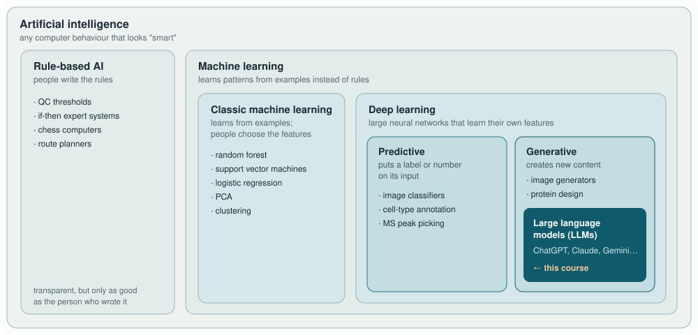

<!-- _class: lead -->
<!-- _paginate: false -->

# Module 1
## Foundations, Ecosystem & Privacy

What an LLM does, and where our data may go

<!--
Session plan (2 h): 10 min recap/orientation, 35 min slides, 15 min live
demo, 40 min exercise + mini-experiment, 20 min discussion.
-->

---

## Learning objectives

1. Explain next-token prediction, tokens and context windows, and predict
   two failure modes that follow from them
2. Compare cloud and local models for a concrete lab task
3. Classify a dataset and choose an allowed tool
4. Run and benchmark a local model with Ollama

<!--
Ask participants to rate themselves 1-5 on each objective in the dashboard
now. They rate again at the end.
-->

---

## First: what are we even talking about?



This course is about the innermost doll.

<!--
Keep it light. Ask: who has used machine learning without calling it AI?
(Random forests, clustering, cell-type classifiers all count.) The full
plain-language explanation is part 1 of this module's chapter.
-->

---

## Predicting vs generating

| Predictive AI | Generative AI |
|---|---|
| Puts a label or number on things | Makes new things |
| "Is this a dendritic cell?" | "Write me a function that normalises this lipid table" |
| Classifiers, random forests | ChatGPT, Claude, local models |

Also AI, but not a chatbot: AlphaFold, cell-type annotation tools, MS peak pickers.

---

## Six words you'll hear all day

| Word | In plain language |
|------|-------------------|
| **Model** | The trained "brain": a huge file of numbers |
| **Token** | A chunk of text, ≈ ¾ of a word. You pay per token |
| **Prompt** | Everything you send it |
| **Context window** | What it can "see" at once, including the whole chat so far |
| **Hallucination** | Fluent, confident, wrong |
| **Temperature** | The randomness dial: low for code, high for brainstorming |

<!--
Don't drill these. People will pick them up. Point to the glossary in the
sidebar of the dashboard.
-->

---

## Four ways you'll meet AI

| | What it is | Example |
|---|---|---|
| **Chatbot** | An app you type into | claude.ai, ChatGPT, Gemini |
| **API** | Code talking to a model | Your Python script (Module 2) |
| **Agent** | A model that can also *do* things: read files, run code | Claude Code (Modules 4–5) |
| **Local** | A model running on your own laptop | Llama via Ollama (today!) |

Cloud = the company's computer. Local = yours.

<!--
The cloud vs local split is the most important practical idea of the
course. Everything about privacy follows from it.
-->

---

## An LLM predicts the next token


- Knowledge = patterns in weights, frozen at a training cutoff
- No lookup unless you give it a **tool** (Module 4) or the **text** (Module 2)

<!--
The figure shows the whole loop: predict, pick, append, repeat.
The single most important idea of the course. Everything else, hallucination,
arithmetic errors, sensitivity to phrasing, follows from it. Original
architecture: Vaswani et al. 2017 (References page).
-->

---

## Consequences for scientists

| Strength | Weakness |
|----------|----------|
| Code, structured text, formats | Exact arithmetic and statistics |
| Sequence patterns (FASTA, SMILES, `PC 34:1`) | Facts it saw rarely in training |
| Summarising, reformatting, extracting | Citations: plausible ≠ real |
| Explaining concepts | Knowing what it does not know |

> Fluent is not the same as correct.

<!--
Example to show live if time allows: ask a model for the mean of 15 numbers
and compare with Python. Ask for three references on a niche topic and check
one in PubMed.
-->

---

## Tokens and the context window

- Text → sub-word tokens (≈ 0.75 words per token)
- `ENSG00000111640` → ~6–8 tokens; lipid names split oddly too
- **Context window** = everything the model can attend to at once
  (prompt + history + files + answer)
- Cloud flagships: ~128k–1M tokens · local models: often 4k–128k

<!--
Tokens determine cost and what fits. Chat interfaces resend the whole
conversation every turn, so long chats get expensive and less precise.
-->

---

## Bigger context ≠ better answers

- Information in the **middle** of long contexts is used less reliably
  (Liu et al. 2024, "Lost in the middle")
- Long chats accumulate noise: "context rot"
- Practical rules:
  - new task → new session
  - give the 10 relevant lines, not the 50-page dump
  - move recurring instructions into files (Module 3)

<!--
This is why later modules focus on structured context, persistent rule files
and subagents with their own clean context.
-->

---

## Cloud vs local

| | Cloud flagship | Local (Ollama) |
|---|---|---|
| Data leaves machine | **Yes** | No |
| Complex multi-step reasoning | Strongest | Weaker |
| Extraction / reformatting | Excellent | Often close |
| Reproducibility | Provider may update | You pin the weights |
| Cost | Per token | Hardware |

Hybrid: cloud model writes code on **synthetic** data → you run it locally on real data.

<!--
Hardware rule of thumb: 7-8B model ~6-8 GB RAM/VRAM; 14B ~10-12 GB; 32B+
needs a workstation GPU or 32 GB+ Apple Silicon.
-->

---

## Where your data goes


Only the right-hand side keeps unpublished data on your machine.

---

## Which tool? First the data, then the task


<!--
Walk through it top-down. The order is the point: the data question always
comes first. Restricted data never goes to a cloud tool; confidential data
only to a local model or an institution-approved tool (check which ones we
actually have). Only then does the task decide the tool.
-->

---

## What happens to a cloud prompt

1. **Transmission** to the provider (always)
2. **Processing** on their servers (always)
3. Retention / logging (settings, contract)
4. Training use (settings, contract)
5. Possible human review (abuse monitoring)

Zero Data Retention (ZDR) removes 3–4 for covered features. It does **not** remove 1–2.

<!--
Details and the account-type table are in part 3 of the chapter.
Stress that coding agents read files on their own initiative; those files are
transmitted too.
-->

---

## Classify before you paste

| Class | Example | Cloud LLM |
|-------|---------|-----------|
| Public | GEO data, published papers | ✅ |
| Internal | Code, protocols | ✅ with training opt-out |
| Confidential | Unpublished DEGs, lipid matrices, drafts | Approved contract only, else local |
| Restricted | Patient/donor data, DUA data | ❌ never |

When in doubt: one class higher.

<!--
Quick exercise: give three examples from participants' own work and classify
them together.
-->

---

## Five habits

1. Classify before you paste
2. Send **structure**, not values (columns, types, 5 synthetic rows)
3. Strip identifiers and paths from logs and tracebacks
4. Check your account privacy settings (and note the date)
5. Never put secrets in prompts; rotate anything that leaked

<!--
Show the pseudonymise/scrub_paths helpers from the docs file.
-->

---

## Can you tell what AI made?

| | What it is | Survives copy-paste? |
|---|---|---|
| **Watermark** | Hidden pattern in the word choices, added by the AI company | Yes, weakens with editing |
| **Content Credentials** | Signed label in a file's metadata (images, files) | No, a screenshot removes it |
| **"AI checker"** | Software guessing from writing style | Unreliable and biased |

Since 2 Aug 2026 (EU AI Act): Claude watermarks text worldwide, Gemini since 2024, ChatGPT in the EU.

<!--
Key point: the watermark is invisible; only the company holding the secret
key can check it. Local models (Ollama) add none. Sources and details:
Module 1 guide, part 4. Liang et al. 2023 for detector bias against
non-native writers.
-->

---

## What it means for us

- A watermark shows **likely AI involvement**, not authorship or correctness
- **Disclosure stays our job**: journals expect it, watermark or not
- **Never** judge a colleague or student with an AI checker
- Figures: look for Content Credentials; absence proves nothing

<!--
Discussion starter: should anyone be able to check watermarks, or only
the companies and selected organisations? (Critical question 6.)
-->

---

## Live demo: a model on your laptop

```bash
ollama pull llama3.1:8b
python exercises/test_ollama_local.py
python exercises/test_ollama_local.py --backend sdk --stream
```

- Note tokens/s and load time
- Disconnect the network and run again

<!--
Run it live. Disconnecting Wi-Fi during the demo makes the privacy point
memorable.
-->

---

## Mini-experiment: are the citations real?

- Ask for 10 papers on CCR7-dependent DC migration (public topic)
- Verify each in PubMed / doi.org
- Score: correct · partial · fabricated
- Compare a local and (if allowed) a cloud model

Write your hypothesis **before** you run it. Details: `self_check.md`.

<!--
With n = 10, intervals are wide. That is part of the lesson: small
samples, big uncertainty. Background: Walters & Wilder 2023, Sci Rep.
-->

---

## Critical questions

- "Right most of the time": measured how, against what?
- Can someone reproduce your AI-assisted analysis after the model is updated?
- Is "anonymised" patient lipidomics really anonymous?
- Who decides the trade-off between privacy and capability?

<!--
Pick two for group discussion (10 min). The others are in self_check.md.
-->

---

<!-- _class: lead -->

# Done when

Local model runs · experiment table filled · data classes known by heart · privacy settings checked

**Next:** Module 2 – Prompting & Context

<!--
Ask for the confidence re-rating in the dashboard. Homework: finish the
mini-experiment if not done.
-->
