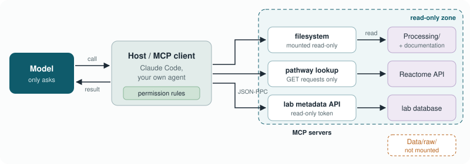

<!-- _class: lead -->
<!-- _paginate: false -->

# Module 4
## Model Context Protocol & Data Connections

Letting models reach files and databases, read-only by default

<!--
Recap: Modules 1-3 were about what we put into the context by hand. Today
the model fetches context itself, through tools.
-->

---

## Learning objectives

1. Explain the MCP architecture
2. Configure a server with least privilege
3. Identify data exfiltration, tool poisoning and supply-chain risks
4. Compare grounded and ungrounded answers against a ground truth

---

## Why tools?

Module 1: without a tool, the model answers from frozen weights.

With tools it can:
- look up Reactome / KEGG / Ensembl / LIPID MAPS / HMDB **now**
- read a project's documentation
- query a sample-metadata database

…and every lookup is a place where things can go wrong or leak.

---

## MCP in one picture



- The model only **requests** a call; the client **executes** it
- One server works with any MCP-capable client ("USB-C for AI")

<!--
Emphasise the second-to-last bullet: permissions belong on the client and
server side, not in the prompt.
-->

---

## Core concepts

| Concept | Meaning | Example |
|---------|---------|---------|
| Tools | Functions with a JSON schema | `reactome_pathways_for_gene("Ccr7")` |
| Resources | Read-only data to load | `file:///…/Processing/README.md` |
| Prompts | Reusable templates from the server | "Summarise this lipid class shift" |
| Transport | How client and server talk | `stdio` (local) · Streamable HTTP (remote) |

---

## A minimal server

```python
from mcp.server.fastmcp import FastMCP
import requests

mcp = FastMCP("pathway-lookup")

@mcp.tool()
def reactome_pathways_for_gene(gene_symbol: str, species: str = "Mus musculus") -> list[dict]:
    """Reactome pathways containing a gene (GET only, public API)."""
    r = requests.get("https://reactome.org/ContentService/search/query",
                     params={"query": gene_symbol, "species": species, "types": "Pathway"},
                     timeout=30)
    ...

mcp.run()
```

`claude mcp add pathway-lookup -- python pathway_server.py`

<!--
The server can only do one thing: GET requests to one public API. That
narrowness is the security feature.
-->

---

## Least privilege

- **Read-only by default**; write tools only for a task, then remove
- **Narrow scope**: `ProjectDocumentation/`, `Processing/`, never `~` or `C:\`
- **Exclude** `Data/raw/`, patient data, `.env`
- **Database role** with `SELECT` only; SQLite `mode=ro`
- **Secrets** via `${ENV_VAR}`, never literal in config

---

## Read-only you can prove

The reference filesystem server *has* write tools. So:

```text
docker run --rm -i --network none
  --mount type=bind,src=$PWD/Processing,dst=/projects/Processing,readonly
  mcp/filesystem /projects
```

plus client deny rules: `"deny": ["Edit(Data/**)", "Read(Data/raw/**)", "Read(.env)"]`

> Read-only protects your files. It does not keep them confidential from a cloud model.

---

## Risks

| Risk | Example | Mitigation |
|------|---------|------------|
| Exfiltration | Tool reads `Data/`; contents sent to cloud | Scope, deny rules, local model |
| Tool poisoning | Malicious instructions in tool description/results | Trusted servers, read-only, HITL |
| Supply chain | Unpinned package changes behaviour | Pin versions, review code |
| Silent failure | API changes, tool returns `[]` | Tests, logging, sanity checks |

---

## Exercise

1. Copy `sample_mcp_config.json` → `.mcp.json` in a scratch ENCORE project
2. `/mcp`: confirm servers and tools
3. "Which analyses exist in Processing/?" and watch the tool calls
4. Try to write via the read-only server, then try to read `Data/raw/`
5. Stretch: build `pathway_server.py`, ask for Ccr7 / Cd86 / Sptlc2 pathways

---

## Mini-experiment: does grounding help?

- 8 genes (DC + lipid metabolism)
- Ground truth from reactome.org
- Model **from memory** vs model **with the Reactome tool**
- Precision and recall per condition

Scoring table in `self_check.md`.

<!--
Typical result: memory answers are plausible but include non-existent or
wrong-species pathway names. Discuss name vs identifier matching.
-->

---

## Critical questions

- What is your threshold for installing someone else's MCP server?
- A tool silently returns empty lists. Who notices?
- Grounded answer = "correct" or "consistent with one database release"?
- Should an agent ever write to the lab's LIMS?

---

<!-- _class: lead -->

# Done when

Read-only connection working · failed write documented · grounding experiment scored

**Next:** Module 5 – Agents & Subagents
