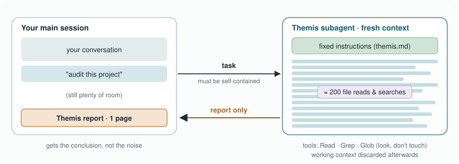

# Module 5 · Agents & Subagents

It's Thursday afternoon and the normalisation script fails on batch 3. You
open a coding agent and type: *"Find out why the normalisation fails on
batch 3."* Then you watch. It reads the script. It notices the script expects
a column called `TIC`. It opens the batch 3 file and reads the header. In
that file the column is called `tic_total`. It comes back with the cause and
a one-line fix, two minutes after you asked.
Nobody told it which files to read or in which order. It decided each next
step itself, based on what it had just seen. That's what makes it an
**agent**, and it's genuinely useful. It's also exactly why this chapter
spends as much time on limits as on possibilities. Something that chooses
its own next step can choose a wrong one, and if it can edit files or run
commands, a wrong step does more than produce a wrong sentence.

In this chapter we put the previous modules together: a model (Module 1),
good instructions (Modules 2 and 3) and tools (Module 4), running in a loop.
We'll see when an agent is the right choice and when a plain script is
better, how *subagents* keep work scoped and tidy, which safety patterns
make agents trustworthy, and we'll meet **Themis**, our own strictly
look-don't-touch project auditor. Then you build a helper of your own.

> **In this chapter**
> - **What is an agent?** A model in a loop with tools, where the idea came from, research modes, and when a script is better
> - **How do I keep agents manageable?** Subagents, and which building block (script, `CLAUDE.md`, skill, hook, MCP server, subagent) you need
> - **How do I keep agents safe?** Read-only first, human approval, circuit breakers, and what an agent sends to the cloud
> - **What does a real one look like?** Themis, our ENCORE auditor, and a little mythology for naming your agents
> - **Time:** about 35 minutes of reading, the *Examples* step (about 20 minutes), and about 90 minutes for the exercises
> - **You need:** Modules 1–4; Claude Code; a scratch copy of the ENCORE template with git set up

> **Good to know:** you may already be using agents without calling them
> that. The "deep research" or "research" modes in ChatGPT, Gemini and
> Claude are agents: they plan searches, read dozens of pages and write a
> report. So are "agent" modes that click through websites for you, and
> Copilot agents in Microsoft 365. This chapter helps you judge them as a
> user: what they did, what they may have got wrong, and what to check.
> The parts about building your own subagent are for people who use coding
> tools; you can skim them.

> **Tip:** read part 3 of this chapter before the exercises. Agents read
> files on their own initiative, so the data questions from Module 1 matter
> more here than anywhere else.

---

## 1. What is an agent?

### How is an agent different from a chatbot?

So far, every interaction in this course has been one question and one
answer, or at most one tool call. An agent removes that limit. It's worth
being precise about what that means, because "agent" is used loosely in a
lot of marketing.
It helps to line up the three ways you can reach the same model. A
**chatbot** is the app you type into: you ask, it answers in text. An
**API** is a way for code to talk to a model: your script sends a prompt and
gets an answer back, as in the Module 2 exercise. And an **agent** is a
model that can also *do* things: read and edit files, run code, search. The
model inside can be exactly the same; what changes is how much it is
allowed to act on its own, and so how much care it needs.

Put more precisely, an agent is a model running in a loop with tools:

```
     ┌──────────── goal ────────────┐
     ▼                              │
   PLAN ──► SELECT TOOL ──► EXECUTE ──► OBSERVE ──► done? ──no──┘
                                                      │
                                                     yes ──► report
```

You saw this loop in Module 2 under the name ReAct: think, act, observe,
repeat. The idea of an AI "agent", a program that perceives its
surroundings and acts towards a goal, is decades old; it is how the most
widely used AI textbook
([Russell & Norvig](https://en.wikipedia.org/wiki/Artificial_Intelligence:_A_Modern_Approach)) has defined the whole field since the 1990s. What's
new is putting a language model in the driver's seat. In spring 2023, a few
months after ChatGPT appeared, hobby projects such as [AutoGPT](https://en.wikipedia.org/wiki/AutoGPT) wired GPT-4
into exactly this loop and promised assistants that would run whole
projects on their own. In practice they mostly went round in circles,
burned through money and got stuck, and the hype faded within months. The
loop wasn't the problem; the models weren't yet reliable enough at each
small step. By 2025 they were, at least for well-defined work such as
code, and coding agents like Claude Code became everyday tools. They read files, search, run commands
and edit code inside this loop. Each step is a small, ordinary action; what
makes it an agent is that the model chooses the next step itself, based on
what it just saw.

Go back to the batch 3 story and you can see the loop: plan (look at the
script), act (read it), observe (it expects `TIC`), plan again (check the
batch 3 file), act (read the header), observe (it's called `tic_total`),
done (report). Five small steps, none of them clever on its own. The value
is in chaining them without you having to direct each one.

<details class="think"><summary>Pause and think: in the batch 3 story, at which step could the agent have done damage if it had more permissions?</summary>

At the end, if it had been allowed to "fix" things on its own. A reasonable
fix is renaming the column in the script. A less reasonable one is renaming
the column in the batch 3 *data* file, which would change raw data. An agent
with edit rights and no approval step might choose either. With read-only
tools, the worst it can do is report the wrong cause, which you'd catch
when you look at the file yourself.

</details>

### Which agents might I already use?

The agent you're most likely to meet is a **research mode**: you ask a
question, and a few minutes later you get a long, well-written report with
dozens of citations. It's genuinely useful for getting into a new topic. It
also combines everything we've learned to be careful about: a lot of
generated text, from many sources, written with complete confidence. A few
habits make these reports much more trustworthy. Read the plan, not just
the report: most tools show what they searched and which pages they read,
and if the sources are blogs and press releases, the report is only as good
as those. Check the claims you'll actually use, by picking the three or
four statements that matter and opening the cited source for each: does it
really say that? Ask what's missing, with a question like "what evidence
argues against this?" or "which important studies did you not find?". And
mind the data rules: a research agent sends your question, and anything you
attach, to the provider. A public topic is fine; for your unpublished
results, Module 1 applies.

### When is an agent the right choice?

Agents are exciting, but they aren't always the right tool. The useful
question to ask first is whether you already know the steps.

| Use a fixed **workflow / script** when… | Use an **agent** when… |
|---|---|
| The steps are known and fixed (QC → align → count → DESeq2) | The path depends on what is found (debugging, auditing, exploring) |
| Reproducibility must be exact | Judgment over messy, mixed inputs is needed |
| It runs unattended at scale | A human reviews the outcome |

<!-- speak: A table comparing scripts and agents. Use a fixed workflow when the steps are known, reproducibility must be exact, and it runs unattended. Use an agent when the path depends on what is found, judgment is needed over messy inputs, and a person reviews the outcome. -->

A useful comparison is a lab protocol versus a troubleshooting session. An
RNA extraction follows a fixed protocol: same steps, same order, every time,
and you'd be alarmed if a colleague started improvising. Figuring out why
your RNA yield suddenly halved is different: you look at one thing, which
suggests the next, and the path depends on what you find. Pipelines are
protocols and should stay scripts. Debugging, auditing and exploring are
troubleshooting, and that is where agents shine.
Often the best design is a script that *calls* an LLM at one well-defined
step, as the Module 2 exercise does, rather than an agent that does
everything.

> **In practice: one AI to plan, another to code.** Say you want a script
> that makes the standard QC figures for a new RNA-seq dataset: library
> sizes, a PCA and a sample correlation heatmap. Do the thinking in a chat
> AI, for example the Copilot your organisation provides or a reasoning
> model in Claude or ChatGPT. Describe the data (columns, groups, number of
> samples) instead of pasting it, let it ask its questions, and weigh the
> options together. When you agree, ask it for the plan as a Markdown file
> and save it as `PLAN.md` in the project. Now switch to the coding agent,
> such as Claude Code in the project folder, and start with a review
> instead of a build: *"Read PLAN.md. Before you write any code, list
> anything that's unclear, risky or missing."* A second model doesn't share
> the first one's blind spots, the same reason a debate between AIs helps
> (Module 2). Settle what it finds, update the plan, and only then let it
> build, one step at a time. If you like, close the loop by pasting the
> finished diff back into the planning chat: *"Does this match the plan?"*
> Before you accept the result, check three things. Did the planning chat
> only ever see descriptions of the data, never the data itself? Where the
> two AIs disagreed, did *you* decide, rather than the last one to speak?
> And does every step in the plan have a check that passed?

> **Coffee note:** there's a lot of excitement about "fully autonomous AI
> scientists". Maybe one day. For now, the most useful agents in a lab are
> boring ones: they do one tedious job, they can't break anything, and they
> hand you a report to check.

> **In short**
> - An agent is a model in a loop with tools: plan, act, observe, repeat. It chooses its own next step, which is both its use and its risk.
> - Research modes are agents too: read the plan, check the claims you'll use, and mind the data rules.
> - Use scripts for fixed, reproducible steps and agents for debugging, auditing and exploring; often the best design is a script with one AI step inside.

---

## 2. How do I keep agents manageable?

### What is a subagent?

Once you start using agents, a practical problem appears: they make a mess
of your conversation. An agent that audits a project might read two hundred
files. All of that ends up in your context window, and (as we saw in Module
1) a context full of noise makes everything after it worse. Subagents are
the fix.
A **subagent** is a specialised agent that the main agent (or you) hands a
scoped task to. Four properties define it. It has one clearly defined job,
such as "audit the ENCORE structure" or "review this script for
reproducibility problems". It has its own, isolated memory: it starts with
a fresh context window, doesn't see your main conversation, and its own
intermediate work (dozens of file reads and searches) never enters yours.
Its instructions are fixed, in a version-controlled file
(`agents/themis.md`), so it behaves the same way every time, for every lab
member. And it gets only the tools its job needs: Themis has `Read`, `Grep`
and `Glob`, so no editing, no shell and no network.

Each property solves a real problem. A scoped task keeps the agent from
wandering off. Isolated memory keeps its work from cluttering yours, and
keeps your half-finished thoughts from confusing it. Fixed instructions mean
the audit you run today is the same audit a colleague runs next month (this
is Module 3's idea, applied to agents). And restricted tools turn "please
don't edit anything" from a polite request into a guarantee (Module 4's
idea). Together they make a subagent something you can trust with a boring,
repetitive job, the way you'd trust a well-written protocol in the hands of
a careful technician.



*The noisy work stays in the subagent's context, which is discarded; you only get the report.*

#### When to build one

> **It's okay:** if you don't use coding tools, you won't build subagents
> yourself, and that's fine. The idea is still worth knowing, because more
> and more apps work this way behind the scenes: a main assistant that hands
> parts of a job to specialised helpers.

Build a subagent when a task generates a lot of noisy intermediate work,
when it needs the same specific instructions every time, or when it should
run with tighter permissions than your main session. Don't build one for
quick, one-off questions; just ask.

#### Anatomy of an agent file

A subagent is a single text file. In Claude Code it's a Markdown file with
a short header between two `---` lines, followed by its instructions:

```markdown
---
name: themis                       # lowercase, hyphens; how you call it
description: When to use it ...    # used to decide when to delegate: be specific
tools: Read, Grep, Glob            # leave it out and it inherits ALL tools
model: inherit                     # or a specific model
---

System prompt: role, constraints, procedure, output format.
```

Two lines in that header do most of the work. The `tools` line is the
security boundary: leave it out and the agent inherits every tool,
including editing files and running commands, so always list the tools
explicitly. The `description` decides when the main agent hands work over,
just like a skill's description in Module 3, so say plainly what it does
and when to use it ("Use when…"). The rest of the file is the agent's own
briefing, written the way Module 2 taught you: role, constraints, steps
and the format of the report.

Where you put the file decides who gets it. In `~/.claude/agents/` (on
Windows `%USERPROFILE%\.claude\agents\`) it's yours, in every project; in
`<project>/.claude/agents/`, committed to git, everyone working on that
project gets it, and that copy wins when both exist. You can also create
one interactively with `/agents` and then edit the file it makes. Other
tools use the same four ingredients under different names: the Claude
Agent SDK reads the same files; the OpenAI Agents SDK, LangGraph, CrewAI
and smolagents each have an "agent" or "node" with its own instructions,
its own message history and an explicit list of tools; and coding tools
such as Codex CLI, Gemini CLI or OpenCode have named agents, modes or
profiles. Whatever the tool: list the tools explicitly, start read-only,
cap the number of steps, and keep the definition in git. The *Examples*
step shows the same idea as about fifty lines of
Python with a local model.

<details class="think"><summary>Pause and think: why is "it does not see your main conversation" an advantage, not a limitation?</summary>

Two reasons. First, your conversation may contain half-formed ideas,
earlier wrong guesses and things that are irrelevant to the audit; a fresh
context keeps those from steering the subagent. Second, it makes the result
reproducible: anyone who gives the subagent the same task gets the same kind
of answer, regardless of what they discussed beforehand. The cost is that
you must put everything it needs into the task description. That's Module 2
again: a good briefing.

</details>

### Which building block do I need?

By now you've met quite a few building blocks: prompt templates and scripts
(Module 2), `CLAUDE.md`, skills and hooks (Module 3), MCP servers (Module 4),
and now agents and subagents. They overlap, and the names don't help. "Should
this be a skill or a subagent?" is one of the most common questions people
ask once they start, so let's put them side by side.
The trick is to ask a few questions in a fixed order. The first one is always
the same as in *When is an agent the right choice?*: do you already know the
exact steps? If so, you
don't need anything clever; you need a script. After that, the questions are
about *how often* something applies, *how strictly* it must be enforced, and
*what* the model needs to reach.


*Which building block? Ask the questions in order; often you'll end up combining a few.*

<!-- speak: The figure is a decision guide with six questions, asked in order. One: do you know the exact steps, and must it run the same way every time? Then write a script, with one AI step inside if needed. Two: should it apply to almost every task in the project? Then put it in CLAUDE.md. Three: must it happen every single time, with no exceptions? Then use a hook or a permission rule. Four: does the model need data or a service it can't see? Then an MCP server, read-only. Five: is it a recurring workflow you do now and then? Then a skill. Six: is it a big, noisy job that should run on its own, with fewer permissions? Then a subagent. If none of these apply, just ask in the chat or let the main agent do it. Often you combine several. -->

Here are all of them in one table, with an example from our own work:

| Building block | What it is | When it runs | Example in our lab |
|----------------|-----------|--------------|--------------------|
| **Chat** | You ask, it answers | When you ask | "Explain this DESeq2 error" |
| **Script with an LLM step** | Fixed code that calls a model at one point | When you run it | Pathway annotation of a DEG list (Module 2) |
| **Prompt template** | A reusable, versioned prompt with slots | When a script fills it in | `structured_bio_prompt.json` |
| **`CLAUDE.md`** | Short project rules | At the start of every session | "Never write to `Data/raw/`" |
| **Skill** | A named recipe with instructions, maybe scripts | When the task matches its description | `deg-report`: the lab's standard DE report |
| **Hook / permission rule** | A command or rule the software enforces | Always, on an event | Run the linter after every edit; deny edits in `Data/` |
| **MCP server** | A door to data or a service | When the model asks for that tool | Reactome pathway lookup |
| **Subagent** | A separate helper with its own memory, instructions and tools | When you or the main agent delegate to it | Themis, the ENCORE auditor |
| **Agent** | A model in a loop with tools | When you start it | A Claude Code session finding the batch 3 bug |

<!-- speak: A table of nine building blocks. A chat answers when you ask. A script with an AI step runs fixed code that calls a model at one point. A prompt template is a reusable prompt a script fills in. CLAUDE.md holds short project rules loaded every session. A skill is a named recipe loaded when the task matches. A hook or permission rule is enforced by the software on every event. An MCP server is a door to data, used when the model asks for that tool. A subagent is a separate helper with its own memory, instructions and tools. And an agent is a model in a loop with tools, which you start yourself. -->

The two that get mixed up most are skills and subagents, so it's worth
spelling out the difference. A **skill** is a set of instructions that gets
loaded *into your current conversation*: same memory, same tools, same
permissions. It changes *how* the agent you're talking to does a job. A
**subagent** is a *different worker*: it starts with an empty memory, has its
own instructions and only the tools you gave it, and hands back a report.
Use a skill for "do this the way our lab does it"; use a subagent for "go and
do this separately, and don't touch anything you don't need".

<details class="think"><summary>Pause and think: you want every new analysis folder to get a README, and you also want to check your old projects for folders that don't have one. Which building blocks?</summary>

Two different ones, because they're two different jobs. For new folders: a
rule in `CLAUDE.md` ("every new folder in Processing/ gets a README with
inputs, outputs and the command to run it"), so the agent does it while it
works. If it really must never be skipped, a hook could check for it. For the
old projects: an audit, which is a big, read-only, repetitive job, so a
subagent. That's exactly what Themis does.

</details>

<details class="think"><summary>Pause and think: a colleague turned the lab's DESeq2 thresholds into a subagent. Good idea?</summary>

Probably not. Thresholds are a short rule that applies to almost every
analysis, so they belong in `CLAUDE.md` (or in a skill for the full DE
report). A subagent would have to be called explicitly, works without your
conversation, and would add a step for something that's just a convention.
Subagents earn their place for big, separate jobs, not for rules.

</details>

The repository of this course is a small worked example, and you can open
every file on GitHub. We write it over many sessions, so each new chat
needs to know where things stand. That applies to every session, so the
briefing lives in `CLAUDE.md`: what the course is, which branch to work
on, and which style the chapters follow. It also pulls in the roadmap and
the changelog with an `@`, the *running start* from Module 3. Updating
those files at the end of a session takes judgment (was that task
finished, or only started?) and happens when we decide to stop, so it's a
skill: the *wrap-up* skill from Module 3's Examples. One rule must never
fail: nobody commits straight to `main`, the branch participants download.
An instruction would be followed most of the time, so it's a hook, a small
script that Claude Code runs before every command and that blocks a
commit on `main`, whatever the model decides. And there's no subagent,
because nothing in this project is a big, separate job yet. Choosing *not*
to use a building block is part of the decision guide too.

> **In short**
> - A subagent has a scoped task, its own fresh memory, fixed instructions and limited tools; it keeps noisy work out of your conversation.
> - To choose a building block, ask in order: known steps → script; every task → `CLAUDE.md`; must never fail → hook; outside data → MCP; recurring recipe → skill; big separate job → subagent.
> - A skill changes how the current agent works; a subagent is a separate worker.

---

## 3. How do I keep agents safe?

### Which safety patterns help?

Because agents can act, a mistake can do more than produce a wrong
sentence. These patterns keep the risk small without taking away the
usefulness. None of them is exotic; they're the same principles we apply to
any powerful equipment in the lab.

It helps to sort an agent's tools into three tiers of risk, because the
tools it holds define what it can possibly do, whatever its instructions
say:

| Tier | Typical tools | Risk |
|------|---------------|------|
| **Read-only** | Read files, list and search | Low: it can see, not change. With a cloud model, what it reads still goes to the provider |
| **Write** | Edit and create files | Medium: it can change your work; mistakes are usually reversible with git |
| **Execute and external** | Shell commands, network, git push, database writes, outside services | High: side effects may be irreversible or leave your machine |

<!-- speak: A table of three tiers of agent tools. Read-only tools, like reading and searching files, are low risk: the agent can see but not change, although with a cloud model what it reads still goes to the provider. Write tools, like editing files, are medium risk; mistakes are usually reversible with git. Execute and external tools, like shell commands, network access, git push and database writes, are high risk: their effects may be irreversible or leave your machine. -->

Give an agent the lowest tier that does the job, and restrict it by its
tool list, not only by its instructions: "please don't edit files" is a
request, while not giving it an edit tool is a guarantee. Start every new agent read-only and report-only, and add the ability to
write later, deliberately, if ever. Keep a human in the loop: require
explicit approval before any action with side effects, such as editing
code, running pipelines, committing or writing to databases; in Claude
Code, that means keeping the default permission prompts on. Build in
*circuit breakers*: limits on the number of steps, the time and the cost of
an autonomous loop, and a stop after repeated identical errors. Separate the
duties, so that one agent implements and a different one, with read-only
tools, reviews. Never give an agent that processes outside content
(papers, web pages, issue text) tools with side effects in the same step.
And keep an audit trail: agent definitions in git, and a record of which
agent and version produced which report.

You don't hand a new student the keys to everything on day one, you have a
second person check critical steps, there is a stop button, and there is a
log. Agents deserve exactly the same treatment, and with these patterns in
place they're genuinely safe to use on real projects.

> **Watch out:** approval prompts only protect you if you read them. After
> the twentieth "Allow?" it's tempting to click yes without looking. If you
> notice yourself doing that, the agent has too many permissions for the
> task; narrow them instead of clicking faster.

<details class="think"><summary>Pause and think: an agent loops, calling the same failing command again and again. Which pattern catches that, and what does it cost you if it isn't there?</summary>

A circuit breaker: a limit on steps or repeated identical errors. Without
one, a cloud agent keeps going until you notice, and each loop costs tokens,
which means money and, on a shared account, quota for everyone. A local
agent costs only time, but can still fill a disk with logs. A limit of, say,
three identical failures before stopping and reporting is cheap insurance.

</details>

> **Tip:** "git commit and pray" is the joke for those moments right
> before you let an agent loose on your project. Skip the praying, keep the
> commit: with your work saved in git, `git diff` shows exactly what the
> agent changed, and undoing it is a single step. For anything bigger than a small fix, say a change that
> touches more than a couple of files, start in plan mode (Module 2): let
> the agent explore and write a plan, correct the plan, and only then let it
> implement.

### What does an agent send to the cloud?

Everything from Module 1 about where data goes still holds, with one twist:
an agent decides for itself what to read. With a cloud model, the provider
receives not only what you type and the files you attach, but every file
the agent opens on your behalf, including files you never mentioned, the
output of every command it runs (which can contain data rows, paths,
usernames and hostnames), and your `CLAUDE.md`, skills and agent
instructions, in every session. Settings decide what the provider does with
it afterwards; no setting stops the sending itself.

In practice the risks look like this. An agent "exploring" a project opens
files in `Data/` and uploads them without anyone noticing. It reads a
`.env` file or a traceback with a password in it. A log it pastes contains
sample or donor IDs. A PDF or web page it reads contains hidden
instructions. Or it edits, deletes or pushes something you didn't intend.
The fix is a few lines of configuration that the software enforces,
whatever the model decides. In Claude Code you add deny rules to the
project's `.claude/settings.json`, committed so the whole lab gets them:

```json
{
  "permissions": {
    "deny": [
      "Read(./Data/**)", "Edit(./Data/**)", "Write(./Data/**)",
      "Read(./.env)", "Read(./.env.*)", "Read(**/*secret*)",
      "Bash(git push:*)", "Bash(curl:*)", "Bash(wget:*)"
    ]
  }
}
```

Adjust the patterns to your project, and check the current Claude Code
documentation for the exact syntax. Beyond that: run Claude Code from the
project folder, never from your home folder or a drive root; keep raw data
outside the folder the agent works in where you can; add `Data/raw/` and
`.env` to `.gitignore` so they can't be pushed by accident; and for
anything confidential without an approved cloud contract, use a local
model. Module 1 has a checklist for your account settings (*Where does my
data go?*). Claude Code also sends usage statistics and error reports by
default; environment variables such as `DISABLE_TELEMETRY=1` or
`CLAUDE_CODE_DISABLE_NONESSENTIAL_TRAFFIC=1` switch that off (check the
current documentation for the exact names).

Agents can run on a local model too. Several coding agents work with
Ollama, and some Claude-Code-style tools can be pointed at a local model,
but then the reasoning is done by that model, not by Claude, even if the
window looks the same, and it is noticeably weaker on long, multi-step
jobs such as a full project audit. A common middle way is to develop and
debug with a cloud agent on synthetic data, then run the finished code on
the real data locally. Which projects move to a local setup is best decided
together, as a lab, not by each person alone.

> **In short**
> - Read-only first; approval for anything with side effects; limits on steps and cost; a separate reviewer; no side-effect tools near untrusted input.
> - A cloud agent sends everything it reads to the provider: fence off `Data/` and secrets with deny rules, and go local for confidential data.

---

## 4. What does a real one look like?

### Themis, our ENCORE auditor

Themis is our first real example of all of this: a small, strict, read-only
helper that checks whether a project follows the ENCORE structure. It's also
a handy template for building your own.
Themis exists because of a very human problem. ENCORE projects start out
tidy, and then real work happens: folders get renamed, analyses are added
without a README, a path to someone's laptop sneaks into a script. Nobody
does this on purpose, and nobody has time to audit their own project
properly before submission. Themis does that boring audit in a minute or two
and hands you a list to work through.

**ENCORE** is a standard way of organising a computational project (van
Kampen and colleagues, *Nature Communications* 2024,
[doi:10.1038/s41467-024-52446-8](https://doi.org/10.1038/s41467-024-52446-8)):
the same top-level folders in every project, and every folder explaining
what it contains. Themis (`agents/themis.md`) checks that the required
folders (`Data`, `Manuscript`, `Processing`, `ProjectDocumentation`,
`Sharing`, `.navigate`) and root files (`README.md`, `0_PROJECT.md`,
`2_CITATION.md`, `3_LICENSE.md`) are there. It looks for empty placeholder
documentation and undocumented subfolders, broken references between
files, hardcoded absolute paths, vague environment setup and stale project
logs.

It is strictly read-only and returns a structured findings report in chat.
Because it can't change anything, you can run it as often as you like
without worrying. Look at how it uses every idea from this course: a clear
briefing (Module 2), a versioned instruction file (Module 3), least
privilege (Module 4), and a scoped subagent (this module).
The *Examples* step has the rest: what it checks and doesn't, where to
save the file so you can use it, and a version that runs on a local model. Next to it is
a second agent built the same way: Argus, a code reviewer.

<details class="think"><summary>Pause and think: Themis reports "Processing/deseq2 has no README". How would you check whether that finding is right?</summary>

Open the folder and look. It takes ten seconds, and it's the habit that
matters: verify a few findings by hand, every time. Agents can be wrong in
both directions. It might have missed a README with an unusual name
(`readme.txt`), or it might flag something that's fine by your lab's
conventions. Checking two or three findings tells you how much to trust the
rest of the report.

</details>

### What should we call our agents?

Why "Themis"? In Greek mythology, Themis is the Titaness of divine law and
order: the one who knows how things *should* be arranged. For an agent that
checks whether a project follows the ENCORE rules, that felt right. It's also
easy to remember, which matters more than it sounds. Once you have five
helpers, "script-reviewer-v2" and "lipid-checker" blur together. "Ask Themis"
doesn't.
So here's a small lab convention, half useful, half for fun: **pick the
mythology by the kind of job**, so the name hints at what the agent does. And
you learn a little mythology along the way.

| Kind of job | Mythology | Name | Why it fits |
|-------------|-----------|------|-------------|
| Checking, auditing, quality | Greek | **Themis** | Titaness of divine law and order. Checks that a project follows the rules (our ENCORE auditor). |
| | Greek | **Argus** | Argus Panoptes, the giant with a hundred eyes, some always awake. Our code reviewer: bugs, duplication and fragile code (in *Examples*). |
| | Greek | **Mnemosyne** | Titaness of memory, mother of the nine Muses. Keeps project logs and documentation up to date. |
| Writing and knowledge | Egyptian | **Thoth** | Ibis-headed god of writing and wisdom, the scribe of the gods. Drafts methods text from your notes. |
| | Egyptian | **Ma'at** | Goddess of truth, balance and order; hearts of the dead were weighed against her feather. Verifies claims and references. |
| Stories and literature | West African (Akan) | **Anansi** | The spider who won all the world's stories from the sky god Nyame. Searches and answers from a collection of papers (Track B). |
| Building and fixing | Yoruba | **Ogun** | The orisha of iron, metalwork and technology. Builds and repairs pipelines and code. |
| Fetching and reporting | Norse | **Huginn & Muninn** | Odin's two ravens, "thought" and "memory", who fly over the world every day and report back. A pair of research subagents: one looks things up, one summarises. |

<!-- speak: A table of mythology names for agents, grouped by job. For checking and auditing, Greek names: Themis, the Titaness of law and order, our ENCORE auditor; Argus, the giant with a hundred eyes, our code reviewer; and Mnemosyne, the Titaness of memory, who keeps project logs up to date. For writing and knowledge, Egyptian names: Thoth, the ibis-headed god of writing, who drafts methods text; and Ma'at, goddess of truth and balance, who verifies claims and references. For stories and literature, Anansi, the spider from Akan folklore who won all the world's stories, searches a collection of papers. For building and fixing, Ogun, the Yoruba orisha of iron and technology. And for fetching and reporting, Huginn and Muninn, Odin's two ravens of thought and memory, who fly over the world and report back. -->

> **Coffee note:** Anansi is a favourite. In the Akan stories from what is
> now Ghana, the stories of the world all belonged to the sky god Nyame. He
> set Anansi an impossible price for them: capture a swarm of hornets, a
> python, a leopard and a fairy. The small spider managed all four by being
> clever, and from then on they were called "spider stories". A good name
> for an agent whose whole job is knowing what's in the papers.

A few rules keep the fun from getting in the way. The name hints at the
job, but the description has to say it plainly: the `description` field in
the agent file is what the model reads to decide when to use it, so
"Themis" alone isn't enough, while "read-only ENCORE structure auditor" is.
Use one theme per kind of job, so a new name tells you roughly what it
does. Keep a register, a short table in `agents/README.md` with name, job,
tools and version, so everyone knows who's who. And any theme works, as
long as the lab agrees: birds, famous scientists (a "Rosalind" for
structure checks?), Pokémon. The point is that you remember them.

<details class="think"><summary>Pause and think: you build a subagent that reads the methods sections of papers and checks whether our analysis matches what we wrote. What would you call it?</summary>

There's no single answer, but it's a writing-and-truth job, so the Egyptian
corner fits: **Ma'at** if the focus is checking that the text is true to the
analysis, **Thoth** if it mainly drafts or rewrites the methods. Whatever you
choose, the description should say plainly: "read-only; compares the methods
text with the analysis scripts and reports mismatches".

</details>

> **In short**
> - Themis is a read-only subagent that audits a project against ENCORE, built from every idea in the course; always verify a few findings by hand.
> - A memorable name helps, but the description must still say plainly what the agent does; keep a register.

---

## 5. Summary and what's next

### Chapter summary

We started with an agent finding a renamed column in two minutes, and the
realisation that its usefulness and its risk come from the same place: it
chooses its own next step. An agent is a model in a loop with tools, and the
first design question is always whether you need one. Fixed, reproducible
steps belong in a script; agents are for debugging, auditing and exploring,
with a person reviewing the result.

Subagents make agents manageable. Each has a scoped task, a fresh memory,
fixed instructions in a versioned file and only the tools its job needs. The
noisy work stays inside the subagent, and you get a report. Around them we
put the same safety patterns we use for any powerful equipment: read-only
first, human approval for anything with side effects, limits on steps and
cost, a separate reviewer, care with untrusted input, and an audit trail.

Because the building blocks overlap, we put them side by side: ask whether
you know the steps, how often something applies, how strictly it must hold,
and what the model needs to reach, and the right block usually follows. A
skill changes how your current agent works; a subagent is a separate worker.

Themis brings it all together: a strict, read-only auditor that checks
ENCORE structure, built from every idea in the course so far, and named after
the Greek Titaness of law and order. Giving agents names like that, chosen by
the kind of job they do, is a small habit that makes a team of helpers much
easier to remember. Running it,
checking its findings and building a helper of your own is the best way to
make all of this concrete.

**Key points**

- An agent is a model in a loop: plan, act, observe, repeat.
- Use agents where the path depends on what's found; keep fixed pipelines as scripts.
- Subagents: scoped task, isolated memory, fixed instructions, restricted tools.
- Choosing a building block: known steps → script; every task → `CLAUDE.md`; must never fail → hook; outside data → MCP; recurring recipe → skill; big separate job → subagent.
- Read-only first, approval for side effects, circuit breakers, separate review, audit trail.
- Give agents memorable names that hint at their job, and keep a register.
- Verify a few findings by hand, every time.

### Looking ahead

That's the end of the individual modules. In Module 6, the hackathon, you
combine everything in a small team on a real biological question: privacy
choices, structured prompts, shared standards, read-only tool connections
and agents, plus an honest evaluation of whether it actually works. Before
you go, have a look at the *Examples* step for Themis and Argus in full. Prefer a quick recap first? There are [slides for this module](slides.md).

---

## Exercises

The best way to understand agents is to watch one work, check its output,
and then build one yourself.

1. **Run Themis** on a copy of the ENCORE template repository, or a
   finished project whose content is already public. (For a real,
   unpublished project, read part 3 of this chapter first: a copy of a real project still
   contains its unpublished documentation, and a cloud agent sends every
   file it reads to the provider.) Read the report and verify three findings
   by hand. Were any wrong? Why?
2. **Try to make Themis edit something** ("please fix the broken link").
   Observe the refusal and confirm no file changed (`git status`).
3. **Build your own subagent** following
   `exercises/build_custom_subagent.md`.

### No-code version

1. Pick a **public** topic you know well, for example *"the role of CCR7 in
   dendritic cell migration to the lymph node"*.
2. Run it through a research mode (ChatGPT deep research, Gemini Deep
   Research or Claude Research), or ask a chat app with web search on.
3. Look at the plan or list of sources: what kind of sources did it use?
4. Check five claims against the cited sources. How many were fully right,
   partly right, or wrong?
5. Ask it: *"What evidence argues against your conclusion?"* Did that add
   anything?
6. Write three lines: would you trust this report for a grant introduction?
   For a quick orientation? Why?


**Done when** you have run Themis, verified its findings, and committed a
working read-only subagent of your own.

---

**Previous:** [Module 4](../module_04_mcp_and_data/README.md) ·
**Next:** [Module 6 – Hackathon](../module_06_hackathon_and_projects/README.md)
